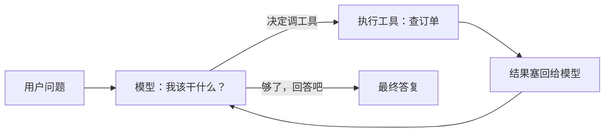

# 01 十五分钟跑通第一个 demo

> **一句话结论**：先看见循环，再谈判断。这一讲你只需要做一件事——把 `demos/01_agent_loop.py` 跑起来，然后看懂三个场景的区别。

---

## 一、先跑起来（3 分钟）

不需要 API Key，不需要装任何东西。Python 3.9 以上即可：

```bash
git clone <本仓库地址>
cd ai-pm-agent-course
python demos/01_agent_loop.py
```

你会看到三段输出。**不要急着读代码，先读输出。**

---

## 二、场景 A：一个 Agent 正常跑完，长什么样

```
[第 1 步] 模型 → tool
        工具 search_orders({'query': '退款'}) → 订单 A123：……支持 7 天无理由退款。
[第 2 步] 模型 → text
结果：ok，用了 2 步
```

这就是 Agent 的全部秘密，翻译成人话：



**模型不执行任何东西，它只会「说话」。** 说「我要调用 search_orders」，外面那圈代码去执行，再把结果喂回来。所以：

- 模型是**决策者**（下一步干什么）
- 代码是**执行者**（真的去干）
- 那圈 `for` 循环是**项目经理**（数着步数、看着预算、随时喊停）

产品视角的关键在于最后一句：**这圈循环的规则是你定的，不是模型定的。**

---

## 三、场景 B：把停机条件拿掉，它就开始烧钱

```
[第 1 步] search_orders → 退款……
[第 2 步] calc(1+1) → 2
[第 3 步] search_orders → 物流……
[第 4 步] calc(2+2) → 4
结果：max_steps —— 4 步里没有一步产出结论
```

四步，四个工具调用，零结论。每步都在花钱，而且每一步看起来都"很合理"。

这就是 Agent 最典型的失败：**它不会报错，它只会一直干下去。**

所以 `max_steps` 不是技术参数，是**预算条款**。写进 PRD 的那句话应该是：

> 「单次会话最多 4 步工具调用；超限时回复『这个我需要人工帮你确认』并转接。」

而不是「步数可配置」——「可配置」等于「没人定」。

---

## 四、场景 C：工具返回空的时候，它编不编

```
[第 1 步] search_orders('发票') →（工具返回空。没有找到相关数据，请如实告知用户，不要猜测。）
[第 2 步] 模型 → text：系统里没查到您的发票记录，我先帮您转人工……
```

注意括号里那半句：**「请如实告知，不要猜测」**。

这半句是代码注入的，不是模型自己的觉悟。有它，模型说"没查到"；没它，模型有很大概率编一个发票号出来——因为它的目标是"给出有用的回答"，而"没查到"听起来不像有用的回答。

**这是整门课里最便宜的一个产品决策**：一句兜底文案，写与不写，差一个幻觉事故。

---

## 五、把三个数字抄回你的 PRD

跑完 demo，你的 PRD 里应该多出这三行：

| 项 | 示例值 | 谁定 | 定不下来会怎样 |
|---|---|---|---|
| `max_steps` | 4 | 产品 | 死循环，成本不可控 |
| 超限文案 | 「我转人工帮你确认」 | 产品 | 用户看到技术错误 |
| 空结果策略 | 「没查到 + 转人工」 | 产品 + 工程 | 模型开始编 |

工程负责实现，**你负责这三个值**。这就是「产品经理要懂内部」的具体含义——不是让你写代码，是让你知道有这三个旋钮，并且知道拧到几。

---

## 六、30 分钟练习

1. 打开 `demos/01_agent_loop.py`，找到 `max_steps` 那个参数，改成 `2`，再跑一次。观察场景 A 变成了什么结果。
2. 把 `TOOLS` 里 `search_orders` 的描述改成一句含糊的话（比如「查东西」），想一想：模型会怎么误解它？
3. 用一句话写下：你这个产品里，**最该被注入兜底文案**的地方是哪儿。

做完第 1 步你会得到一个重要认知：**停得太早，Agent 会在拿到答案前被掐死**。max_steps 太小和太大都是错的，这个平衡点只能靠跑评测定（第 05 讲）。

---

## 90 秒话术

> 「Agent 的本质是一个循环：模型决策下一步、代码执行、结果回灌。模型本身不执行任何东西。
>
> 所以可靠性不在模型，在循环的约束：最大步数、停机条件、重复调用检测、空结果兜底。这四个我在 PRD 里都会写死具体值，因为『可配置』等于没人负责。
>
> 比如空结果那句兜底文案——有它，模型说『没查到，我转人工』；没它，模型会编一个订单号给你。这个差别不花钱，但决定用户信不信你。」

---

**上一讲** ← [00 为什么产品经理要懂 Agent 内部](00-为什么产品经理要懂Agent内部.md)
**下一讲** → [02 Agent 与 Workflow 的分界线](../01-认知/02-Agent与Workflow的分界线.md)
