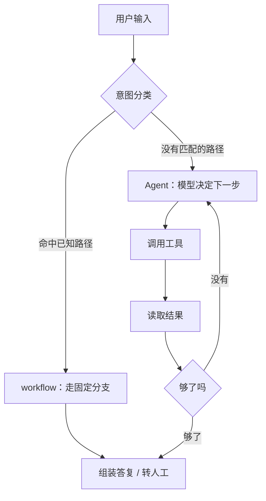

# 02 Agent 与 Workflow 的分界线

> **一句话结论**：判据不是「够不够智能」，而是「**任务的路径能不能事先枚举**」。能枚举，就用 workflow——便宜、可测、错了能定位；枚举不出来的那一小段，才是 Agent 该待的地方。

## 一、为什么 PM 要懂这个

周一评审，工程同学演示「售后智能助手」：用户说「我买的吹风机坏了」，它自己决定查订单、查物流、查退款政策、算折旧、给方案。演示三十秒，很顺。

你问了三个问题，会就变味了：

- 「它一共会走几条路？」——「不一定，看用户怎么说。」
- 「一次多少钱、多久？」——「平均 0.42 元，P95 大概 14 秒。」
- 「它会不会自己编一个赔付方案？」——「……偶尔会。」

你要了 200 条真实会话的 trace（每一步调了什么工具、拿到什么、为什么停），自己数了一遍：

| 走法 | 条数 | 占比 |
|---|---:|---:|
| 查订单 → 判规则 → 答复 | 112 | 56% |
| 查订单 → 查物流 → 答复 | 41 | 20% |
| 查订单 → 转人工 | 18 | 9% |
| 直接答政策（不查单） | 7 | 4% |
| 真的发散（多诉求、带情绪、索赔） | 22 | 11% |

**89% 的会话只有四条路。** 这四条路写成 if/else 的 workflow 版本是 0.08 元/次、P95 1.6 秒；Agent 版贵 5 倍、慢 9 倍，还在那 178 条「本来不会错」的会话里给了 3 次规则里没有的承诺——「可以赔您 50 元」。

会上要下的判断不是「这个 Agent 强不强」，而是：**这 89% 的流量，凭什么付 5 倍的钱，去买一条更容易出错的路径？**

## 二、机制

### 一条分界线：谁在什么时候决定「下一步」

workflow 和 Agent 的差别只有这一句：**「下一步做什么」这个决定，是人在写代码时做完了，还是模型在运行时一步步现场做。**

前者把路径提前写死，后者把路径交给每一次调用。所以判断标准不是「任务复不复杂」，是「**路径能不能事先枚举**」——能不能在一张纸上把用户可能走的路画完。

这张图里最贵的一步不是 `E`，是 `B`——**分类**。它便宜（一次调用、分钱级）、可测（混淆矩阵一画就知道准不准），而且它决定了后面 89% 的钱花在哪。绝大多数「该不该上 Agent」的争论，其实是缺了这一步：把所有流量都当成开放输入，于是只能上 Agent。

### 一张决策表：六个维度打分

每一维给 0 / 1 / 2 分，六项加总：

| 维度 | 0 分（偏 workflow） | 1 分（混合） | 2 分（偏 Agent） |
|---|---|---|---|
| 步骤数 | ≤ 3 步 | 4–8 步 | 多于 8 步，或步数本身不定 |
| 分支数 | ≤ 5 条，画得完 | 6–20 条，规则清楚 | 规则写不出来，要看内容现场判断 |
| 输入是否开放 | 表单、固定意图 | 一句话里可能带两个诉求 | 一段抱怨、一张截图、一段录音 |
| 失败代价 | 答错可撤回、有人兜底 | 答错要返工 | 答错赔钱、担责、不可逆 |
| 延迟要求 | P95 < 3 秒 | 3–10 秒 | 能等 30 秒以上 |
| 能否接受不确定 | 不能，同一问题必须同一答案 | 略有差异可接受 | 只要结果对，过程无所谓 |

- **0–3 分**：workflow。上 Agent 是纯浪费。
- **4–7 分**：workflow 主干 + Agent 兜底。这是绝大多数线上系统的真实形态。
- **8–12 分**：Agent，但必须同时写死步数上限、单次预算和兜底文案。

注意这张表没有「智能程度」这一维。**它不是用来选更强的方案，是用来选更便宜的方案**——便宜方案确实覆盖不了，才往上加钱。

### Agent 的五笔账

为什么大多数需求其实该用 workflow？因为 Agent 的自由是**按步计费**的，而且计价方式比你想的贵：

| 代价 | 内部发生了什么 | 量级 |
|---|---|---|
| 延迟 | 每一步一次模型调用，串行等待；单次 1.5–3 秒 | 5 步就是 8–15 秒，用户已经在看手机了 |
| 成本 | 每步都要把之前全部历史重发一遍，token 是**累积**的 | 步数翻倍，成本约 4 倍，不是 2 倍 |
| 不可复现 | 采样温度、模型版本、工具返回顺序都会改变路径 | 同一句话跑两次，可能走两条路 |
| 难评测 | 路径空间组合爆炸，只能抽样 | 20 题能覆盖主干，覆盖不了分支 |
| 难归因 | 错了要判断：选错工具、工具返回脏、还是停机太早 | 没有 trace 就只能猜 |

最后一行最贵。workflow 出错，你看一眼就知道是哪个 if 分支写错了；Agent 出错，你拿到的是一段「看起来合理的错误」，要复盘得先有 trace，而 trace 往往是上线后才想起来要加的。

### 一个类比：柜台和助理

workflow 像银行柜台：取号、验身份、办业务、签字，每一步贴在墙上，柜员照着做。慢，但你上午去和下午去拿到一样的结果，出错能查出是哪一步。

Agent 像你雇的私人助理：你说「帮我把这事办了」，他自己决定先打给谁、打几次、什么时候停。灵活，但他每办一步都要回来问你一句（这就是一次模型调用），而且他可能在第 6 步忘了你第 1 步说过什么。

**柜台的问题是覆盖窄，助理的问题是贵且不可控。** 现实里最好的形态不是二选一，是大厅里有个分诊台——分诊台决定你去柜台，还是去找助理。

### 反例与正例

**反例**：有团队把「上传发票 → OCR 识别 → 校验税号 → 入账」这四步写死的事，套了个 Agent 壳。上线后成本涨 5 倍，稳定性下降（同一张发票两次跑，一次查了税号库、一次没查），周报上写「我们做了智能体」。这不是 AI，是把 if/else 换成了更贵、更慢、更不可测的 if/else——**而且更难测，因为每次走的都不一定是同一条路。**

**正例**：客服里「查订单 → 按规则判定 → 给方案」是可枚举的，就该是 workflow，规则改了改代码、跑一遍回归就行。只有「用户丢来一段 300 字的抱怨，里面三个诉求两种情绪，自己决定先查什么、查几次」才需要 Agent。两类流量在同一个入口，所以正确形态是路由：一次便宜的意图分类，把 89% 送进 workflow，11% 送进 Agent，两边各有各的评测集。

### 落到 PRD

写「路径是否可枚举 + 失败代价」，不要写「是否足够智能」。能落地的只有四行：

- 枚举出的路径清单：每条路径的触发条件、动作、兜底。
- 允许模型自由决定的那一段（**只写这一段**，其余写死）。
- 这一段的硬约束：最多几步、最多花多少钱、超时多久转人工。
- 每类路径的验收口径：workflow 按分支覆盖，Agent 按抽样。

## 三、产品视角：这条技术决定了什么决策

1. **先问「能不能画成一张流程图」。** 画得完、分支不超过一页 → workflow。代价：放弃对长尾的覆盖，长尾只能转人工或单独做。
2. **用流量分布决定投入，不用「先进性」决定投入。** 80% 以上流量落在 5 条路径内 → 主干 workflow + Agent 兜底。代价：两套逻辑要维护，分诊判错会两头不讨好。
3. **Agent 只能放在「失败可兜底」的位置。** 判断标准是「它错了，最坏结果是什么，谁承担」。代价：能兜底的地方价值通常有限，而高价值场景往往不可逆——这也是金融、医疗的 Agent 落地比客服慢的原因。
4. **先定延迟预算，再定步数上限。** 用户能等 3 秒，就只够 1–2 步；要 5 步就得给进度反馈（「正在查物流」）。代价：步数上限会砍掉一部分本该做对的 case。
5. **把不确定写进文案。** Agent 路径必须能说「我没查到」「需要人工确认」。代价：不如「秒回」显得聪明，但不说的代价是赔钱。

## 四、上手

**跑一遍**：`python demos/01_agent_loop.py`，看场景 B——4 步、每步都「成功」、没有一步产出结论，这就是烧钱但没结果。然后把 `max_steps` 改成 1 再跑：它退化成「一次调用就答」，也就是 workflow 的极限形态。同一份代码，两个产品的差别只在一个参数上，而这个参数该写进 PRD。

**纸上推演（15 分钟）**：拿你手上（或想做）的一个 AI 功能，从后台捞 100 条真实用户输入，逐条手写「它该走哪条路」。

- 100 条能收敛到 8 类以内 → 这就是你的 workflow 主干，先做它。
- 收敛不了，看剩下那堆是不是同一个特征（都是多诉求？都带情绪？）→ 那才是 Agent 的入口。
- 两类都标不出来 → 你还没有产品假设，此时上什么都不对。

交付物：一张「路径 → 占比 → 触发条件」的表，加一句话结论（workflow / 混合 / Agent，以及为什么）。

## 五、常见误判（反面清单）

1. **「场景太复杂，规则写不完，只能上 Agent。」**
   实际：复杂 ≠ 不可枚举。多数「写不完」是没做意图分类，把二十条路径混在一个入口里。
   验证：抽 100 条输入人工标注「该走哪条」，标得出 ≤ 8 类，就说明能枚举。

2. **「Agent 更智能，效果肯定更好。」**
   实际：Agent 提升的是长尾覆盖，不是主干准确率；在主干路径上，它通常不如写死的规则准。
   验证：拿同一批 100 条比「主干路径准确率」，不要比 demo 顺不顺。

3. **「上了 Agent 就不用维护规则了。」**
   实际：规则从代码搬进了 prompt 和工具描述，还是要人维护，而且改完更难回归。
   验证：问工程「改一条退款规则要动几个文件、多久能跑完回归」。

4. **「先上 Agent，跑不通再退回 workflow。」**
   实际：退不回去。prompt、工具、评测集全是按 Agent 写的，退回等于重做。
   验证：看排期里有没有「Agent 路径的评测集」这一项，没有就是没打算退。

## 六、30 分钟练习

交付物：一页 A4，标题写「XX 功能：workflow 还是 Agent」。

1. 用 10 分钟列出这个功能的**全部**路径（按用户意图列，先不管实现），标出每条的业务占比。
2. 用 10 分钟按六维表打分，算出总分，写下结论（workflow / 混合 / Agent）。
3. 用 10 分钟写 PRD 那四行：路径清单、允许自由的一段、这一段的硬约束、验收口径。

做完拿给工程看。如果他第一反应是「这个分类我们做过」或「这段自由其实不需要」，这 30 分钟就赚回来了。

## 90 秒话术

> 「判断该不该用 Agent，我不看聪不聪明，看路径能不能枚举。能在一张纸上画完的路就用 workflow，出错能定位到分支；枚举不出来的那一小段才交给 Agent，配步数上限。
>
> 我复盘过一次售后助手：89% 的会话只有四条路，Agent 版贵五倍、慢九倍，还多给了三次规则外承诺。正确形态是前面加一个便宜的分诊。
>
> PRD 里我只写路径能否枚举、失败代价多大。」

> 想读源码：`demos/01_agent_loop.py`（60 行，看 max_steps、重复调用检测、空结果兜底这三处怎么把「自由」关进笼子）；外部可看 `langchain-ai/langgraph`（看它如何把 workflow 与 agent 写成同一张图）。

**下一讲** → [03 五种骨架与它们的失败模式](03-五种骨架与它们的失败模式.md)
