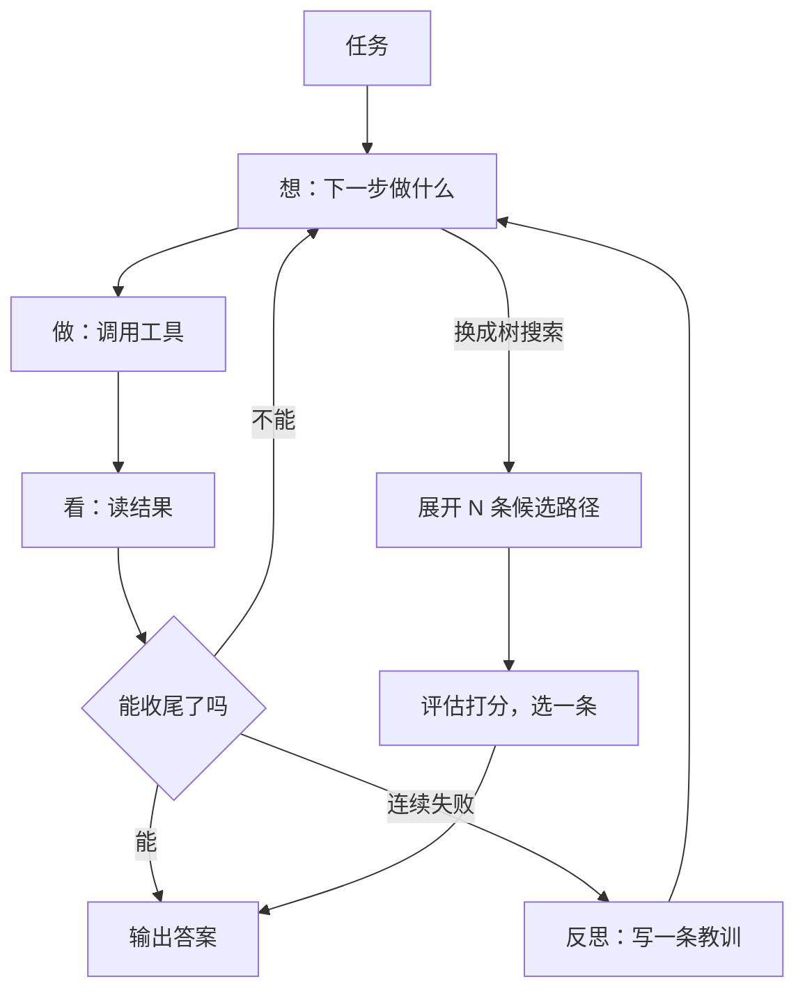

# 03 五种骨架与它们的失败模式

> **一句话结论**：选骨架不是选先进程度，是选**你愿意承担哪种失败模式**。能力越强的骨架，失败得越隐蔽——单次调用错了你一眼看出，树搜索错了你只看到一个「很有道理」的答案。

## 一、为什么 PM 要懂这个

你在评审一个「经营分析助手」：用户问「上周转化率为什么掉了 3 个点」，它自己去查表、算数、给归因。工程给了三个版本，让你挑一个上线。

| 版本 | 20 题评测 | 平均步数 | 单次成本 | P95 |
|---|---:|---:|---:|---:|
| A 单次调用 + 一张宽表 | 11/20 | 1 | 0.06 元 | 1.2 秒 |
| B 边查边想（ReAct） | 15/20 | 4.1 | 0.19 元 | 9 秒 |
| C 多路径试错（LATS） | 16/20 | 12 条路径 | 1.40 元 | 47 秒 |

按分数选，选 C。你差点就选了。

后来你让工程把 C 答对的那 16 题逐条对照数据源，发现 3 题是「证据编得漂亮」：它写着「11 月 8 日大促流量回落」，但 11 月 8 日没有大促；它列的三条依据，两条其实指向同一张表，还有一条对不上口径。**这三题在评测集里算对，在业务上算事故。**

B 错的那 5 题，错法很朴素：查错了表、算错了除法。人一眼能看出来。

所以你要选的不是 16 > 15，而是：**多对一题，换一类你抓不到的错。** 这就是骨架问题——不是「哪个更强」，是「它错了会以什么形式错」。

## 二、机制

### 五种骨架的总表

| 骨架 | 内部循环 | 适用 | 典型失败模式 | 成本倍率 | 评测要点 |
|---|---|---|---|---|---|
| Function Calling | 一次决策 → 一次工具调用 → 结束 | 一问一答、答案在某个接口里 | 该调不调、参数编造；没有纠错机会 | 1× | 工具选择准确率、参数合法率 |
| ReAct | 想 → 做 → 看 → 再想（循环） | 路径不定，要看查到什么再决定 | 原地打转；上下文越滚越脏 | 3–6× | 步数分布、重复调用率 |
| Plan-and-Execute | 先出完整计划 → 逐步执行 | 步骤多但可枚举、要先对齐口径 | 计划错则全错（错误前置） | 2–4× | 计划正确率、重规划触发率 |
| Reflexion | 做 → 失败 → 写反思 → 再来一次 | 有客观反馈信号（测试、对账） | 反思出错误的教训，越改越偏 | 2–5× | 反思是否指向真因（人工看） |
| LATS | 展开多条路径 → 评估打分 → 选最优 | 一次性难题、答案值钱、可离线等 | 成本指数级；评估函数骗你 | 10×+ | 评估函数与人工判断的一致率 |

「成本倍率」是相对单次调用的粗估，真实值取决于步数上限——那个参数比骨架本身更能决定你的账单。

多智能体不在这个表里：它是「把多个骨架拼起来」，判据完全不同，见第 07 讲。

### 一张图看懂循环差在哪

「想-做-看」这条主循环是 ReAct；加上 `G`（写教训再回去）就是 Reflexion；在 `B` 处分出 `H → I`（展开多条再打分）就是 LATS；而 Plan-and-Execute 是把 `B` 提前一次性做完，执行阶段不再问「下一步」——所以它更便宜，也更脆。

现实里很少只用一种。常见的是**外层 Plan、内层 ReAct**：先列 3 个子问题（计划），每个子问题再边查边定（循环）。这时失败模式是叠加的——计划的错会吃掉循环的纠错能力，因为它只会在被划定的那一小块里打转。混搭之前先想清楚：哪一层的错更致命，就把护栏放在那一层。

### 一个反直觉的排序

在同一个模型上，从单次调用换到 ReAct，正确率常能涨 15–25 个百分点；再往上换 LATS，往往只涨 1–3 个点，成本却翻好几倍。原因不神秘：第一次改动给了模型「多拿几次信息」的机会，后面几种只是让它在**同一个信息池**里反复挑。

所以顺序是：**先补信息通路（工具、检索），再换搜索策略。** 信息池没变大，树搜索只是在更小的池子里找得更认真。

### 一个类比：五种新员工

- **Function Calling**：你说一句他做一件，做完就交。不会主动，但也不会乱来。
- **ReAct**：边做边想，走一步看一步。勤快，但会原地打转——同一个表查三次，因为他忘了第一次查过。
- **Plan-and-Execute**：先写方案再动手的项目经理。方案对了很高效；方案第一步就理解错，后面六步都在为错的方案服务，而且每一步都「执行得很成功」。
- **Reflexion**：会复盘的人。但复盘需要知道「为什么失败」，他只知道「失败了」，于是容易把偶然当原因。
- **LATS**：一次请五个顾问各走一条路，最后投票。贵，而且投票规则（评估函数）是你写的——它不准，五人投票只会更自信地错。

### 五种失败模式，具体长什么样

**Function Calling 的失败是静默的。** 它没有第二步来纠正第一步，所以你拿到的是一个「格式正确、语气自信、内容错」的答案。客服里最典型：没查订单就说「支持 7 天无理由退款」。

**ReAct 会原地打转。** 同一工具、同一参数反复调（因为它没记住上次结果），或者工具返回空之后开始编。更隐蔽的是上下文污染：第 6 步的 prompt 里塞着前 5 步的全部返回，其中两条是脏数据，模型会拿脏数据当事实。

**Plan-and-Execute 是错误前置。** 计划一旦把「查退款」理解成「查退款政策」，后面每一步都在正确地执行一个错误的计划。很多实现为了省钱不做重规划，于是一错到底——**它不会崩，它会交付一份完整但错的东西。**

**Reflexion 会反思出错误的教训。** 它看到「这次答案被用户否了」，就写下「下次要先查物流」；真实原因是退款规则上周改了。这条教训还会写进记忆，污染后面十个任务。没有客观反馈信号时，Reflexion 约等于「用同一份信息再猜一次，并且更自信」。

**LATS 的成本是指数级的**（分支数 × 深度），但真正的问题是：它把随机性包装成了「论证充分」。你看到三条理由加一个明确结论，看不到的是另外十一条被丢弃的路径里可能有更对的。

### 关键判断

**能力越强的骨架，失败模式越隐蔽，评测也越贵。**

- 单次调用错了：一眼看出（没查单就说能退）。
- ReAct 错了：翻 trace 能看出它在打转。
- 树搜索错了：你看到一个「看起来很有道理」的答案，还带三条证据。要发现它错，得回到数据源逐条核——**评测成本比前两种高一个量级**。

| 骨架 | 出错时你看到什么 | 靠什么发现 | 发现成本 |
|---|---|---|---|
| Function Calling | 一个自信但错的答案 | 抽一条人工对一遍 | 秒级 |
| ReAct | 转圈、超步数、答非所问 | 看步数与重复调用 | 分钟级 |
| Plan-and-Execute | 每步都有产出，整体结论错 | 人把整条计划读一遍 | 小时级 |
| Reflexion | 试了三次，第三次「看起来」对了 | 固定评测集 + 人工复核 | 天级 |
| LATS | 结构漂亮、论证充分的错答案 | 回数据源逐条核证据 | 周级 |

所以选骨架时，你同时在选三件事：花多少钱、错成什么样、以及**你有多大能力发现它错了**。第三件最容易被漏掉。

## 三、产品视角：这条技术决定了什么决策

选骨架 = 选失败模式。先看四个常见场景该选哪个：

| 你的场景 | 该选 | 为什么 | 你主要防什么 |
|---|---|---|---|
| 客服 FAQ（答案在知识库） | Function Calling + 检索 | 一步能答，多一步都是浪费 | 没召回却硬答 |
| 复杂研究（查多处，结论取决于查到什么） | ReAct + 步数上限 | 路径不可枚举，必须边查边定 | 打转、查了不引用 |
| 代码修复（改 → 跑测试 → 再改） | Reflexion，测试当反馈信号 | 有客观信号，反思才有依据 | 改坏别的文件、反思错方向 |
| 报表生成（口径固定、字段多） | Plan-and-Execute 或纯 workflow | 步骤可枚举，先对齐口径再算 | 计划错 → 整张表错 |
| 一次性难题（尽调、方案对比） | LATS，离线跑 | 可以花一块钱换几个点准确率 | 成本失控、评估函数骗你 |

四条判断标准：

1. **有没有客观反馈信号，决定 Reflexion 能不能用。** 有测试、对账、规则校验 → 反思有依据；没有 → 反思就是猜。代价：没信号时只能靠人抽检，抽检成本要算进排期。
2. **步骤能不能枚举，决定要不要 Plan-and-Execute。** 能枚举且顺序稳定 → 先出计划，人能审；不能枚举 → 上 ReAct，但必须给步数上限。代价：计划模式放弃了处理意外的能力。
3. **答案单价 × 流量，决定 LATS 能不能进线上。** 一般只有离线任务（报告、尽调、离线审核）养得起。代价：用户等待链路里基本用不了。
4. **PRD 里写「它错了会怎么错」，不只写「它有多强」。** 这是唯一能让你在上线后第一时间认出来的东西。代价：写这句要求你先想清楚兜底，而兜底往往要业务方签字。
5. **骨架和评测口径一起定，不要后补。** 单次调用看工具选择准确率，ReAct 看步数分布和终止原因，Plan 看计划可执行率——换骨架就得换一套题。代价：那 20 题评测集通常不能复用，每换一次重做一遍，这笔工时没人报。

## 四、上手

**跑一遍**：`python demos/01_agent_loop.py` 的场景 B——4 步、每步都成功、没有结论，这就是 ReAct 打转的最小样本。注意代码里那处「同一工具、同一参数第二次出现就中止」，它是防打转最便宜的一招。

**纸上推演（15 分钟）**：拿你手上一个需求，把总表抄下来，给五种骨架各写一行：

- 如果选它，最可能的失败是什么？（写具体现象，不写「效果不好」）
- 这个失败，我多久能发现？靠什么发现？
- 发现之后，兜底动作是什么？

写完你会得到一个反直觉的结论：**多数需求该选的是表里最「笨」的那一行**，因为它的失败你看得见。

## 五、常见误判（反面清单）

1. **「多跑几轮总会对。」**
   实际：Reflexion 的收益取决于反馈信号质量。没有信号时，多跑几轮只是把随机性放大，并且让答案更自信。
   验证：同一题跑 5 次，看答案是收敛还是漂移；漂移就说明没有信号。

2. **「先出计划更可控。」**
   实际：可控的是「可解释」，不是「正确」。计划错的那一步，恰好是你能看见、却不一定看得懂的那一步。
   验证：只看计划的第一步对不对；第一步错，后面全废。

3. **「树搜索 = 更准。」**
   实际：树搜索放大的是评估函数的能力。评估函数不准时，它更擅长挑出一个错的。
   验证：把选中路径和落选路径都打出来人工扫一遍；落选里若有明显更对的，评估函数坏了。

4. **「骨架越新越好。」**
   实际：新骨架解决的是旧骨架的某个特定失败，通常会把旧问题换成新问题。
   验证：问「上一版具体错在哪」，答不出具体案例，换骨架只是换运气。

## 六、30 分钟练习

交付物：一张「骨架选型单」，五行写完。

1. 选一个你的场景，写下它的**反馈信号**是什么（测试？对账？用户点踩？没有？）。
2. 用总表给五种骨架各填一行：最可能的失败 / 多久能发现 / 兜底动作。
3. 选一个你能承受的失败，写下骨架名。
4. 最后写一句：如果上线两周后它开始错，我第一个要看的指标是什么。

第 4 问最重要——它决定了你是在做产品，还是在赌。

## 90 秒话术

> 「Agent 骨架我只记五种：单次调用、边想边做、先计划再执行、失败后反思、多路径搜索。它们不是先进程度的排序，是五种失败方式。单次调用错了一眼看得出；边想边做会原地打转；先计划是错误前置；反思会反思出错误的教训；树搜索最贵，还会把随机性包装成很有道理的答案。
>
> 所以我问的不是哪个更强，是它错了会怎么错、我多久能发现。多数场景该选表里最笨的那个，因为它的失败你看得见。」

> 想读源码：`demos/01_agent_loop.py`（一个 60 行的 ReAct 循环，重点看它怎么检测重复调用）；外部可看 `noahshinn/reflexion`（看「反思」被写成了什么结构，以及它依赖哪些信号）。

**下一讲** → [04 RAG 链路与五处手术](../02-知识/04-RAG链路与五处手术.md)
