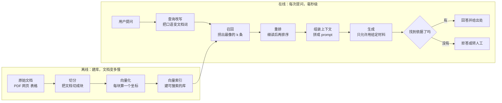

# 04 RAG 链路与五处手术

> **一句话结论**：RAG 的效果上限由切分和召回决定，生成模型只是最后一公里——所以「换个更强的模型」通常修不好 RAG。

---

## 一、为什么 PM 要懂这个

销售在企微群里问：「A 客户要 60 天账期，能签吗？」

系统 3 秒后回：「可以。标准账期 60 天，法务已审。」

销售把这句话截图发给了客户。

三天后法务在合同评审会上看到这份合同，脸白了。《渠道销售合同管理办法 v3.2》第 4.2 条写的是：

- 标准账期 **30 天**；
- 60 天及以上，需 **VP 书面审批**，且客户须提供最近一期审计报告。

系统说的「60 天」，来自另一份《老客户续约政策》——那份文件确实写了「可给到 60 天」，但只适用于「连续合作三年以上」的客户，A 客户是第一年。

工程拉出 trace，三个事实很刺眼：

| 环节 | 实况 |
|---|---|
| 召回 | 返回 12 条，第 4.2 条排在第 9 位 |
| 组装 | 为了省 token，只截取了前 3 条进 prompt |
| 切分 | 第 4.2 条被切成两块，「需 VP 书面审批」那半块落在第 10 条，压根没进 prompt |

工程的第一反应是：「换个更强的模型吧，这个模型不够聪明。」

这个判断错了。复盘过去半年 37 个答错的 case（数字是粗估，量级比精确值重要）：

| 归因 | 占比 | 换个更强的模型能修吗 |
|---|---|---|
| 正确答案根本没被召回 | 约 6 成 | 不能 |
| 召回了，但被切碎或排序靠后，没进 prompt | 约 2 成 | 不能 |
| 进了 prompt，模型读错或没按格式输出 | 约 1.5 成 | 可能 |
| 文档里根本没有这个知识 | 不足 1 成 | 不能 |

八成以上的错误，模型连「看见正确答案」的机会都没有。你在它看不见的地方加钱，等于给一个没拿到卷子的考生换更贵的笔。

---

## 二、机制

RAG 不是「接个向量库」，是一条五段的流水线。前两段离线跑一次，后三段每次提问都跑。



**一个类比你一定见过：图书馆找资料。**

切分 = 把书拆成一叠卡片（拆太碎，卡片上看不出上下文；拆太大，一次只能带几张走）。索引 = 卡片按主题放进抽屉。召回 = 管理员听你一句话，凭感觉抓 20 张卡给你。重排 = 你自己再筛出 3 张真正相关的。组装 = 把 3 张卡摆在桌上。生成 = 你照着这 3 张卡写答案。

关键在这句：**你写出来的东西，不会超过桌上那 3 张卡。** 桌上没有的内容，你要么不写，要么——这是最危险的——用桌上的碎片拼一个读起来很顺的答案。

五处「手术」，每一处治一种特定的病：

| 手术 | 要动的地方 | 典型做法 | 什么时候值得做 | 代价 |
|---|---|---|---|---|
| 一、切分策略 | 建库前 | 按标题/条款切，块间重叠 10–15%，每块补上「所属章节」 | 文档有层级（制度、合同、说明书） | 块数变 2–3 倍，索引变贵，噪声变多 |
| 二、查询改写与多路召回 | 提问后、检索前 | 同义改写、抽关键词、向量 + 关键词双路取并集 | 用户说口语、文档写术语 | 多一次模型调用，延迟 +300ms 起；改写可能跑偏 |
| 三、重排 | 召回之后 | 对 top-50 逐条精读，重新排到 top-5 | 召回池大、正确答案常排在第 10 名以后 | +200–400ms，多维护一个模型 |
| 四、上下文组装与引用 | 拼 prompt 时 | 按相关性排序、每条编号、强制标注 doc_id | 答错有代价、需要人复核 | prompt 变长；引用格式要靠指令约束 |
| 五、兜底与拒答 | 生成前后 | 相似度阈值 + 空结果显式告知 + 转人工入口 | 知识库覆盖不全（几乎总是） | 拒答率上升，体验上会「变笨」 |

把这五处串起来，才是本讲真正要交付的东西——**从症状反推病灶**。这张表建议打印出来贴桌上：

| 你看到的症状 | 病灶在哪 | 该做的手术 | 代价 |
|---|---|---|---|
| 答非所问，答的是另一个主题 | 召回没中，top-k 里没有正确文档 | ② 查询改写 + 关键词混合，先确认原始关键词能不能命中 | 延迟和成本上升，要维护同义词表 |
| 答案是对的，但引用指向了别的文档 | 组装时按分数排序，编号与引用错位 | ④ 把 doc_id 与编号绑定，生成后再做一次引用校验 | 多一次校验调用（规则或模型） |
| 长文档只答一半，后半段的例外没提 | 切分太大被截断，或切太碎丢了前置条件 | ① 按条款切 + 重叠，每块补上章节标题 | 块数翻倍，索引成本上升 |
| 召回 20 条，正确答案排第 15，模型没用上 | 只有召回，没有重排 | ③ 加 rerank，把 top-50 压到 top-5 | +200–400ms |
| 知识库里根本没有这条，它照样答 | 没有兜底与拒答 | ⑤ 相似度阈值 + 空结果话术 + 转人工 | 拒答变多，要设计「拒答之后怎么办」 |
| 文档上周改的，它还在说旧数字 | 索引没重建，或缓存没失效（不是手术，是运维） | 建索引更新流程 | 每日重建的算力，或实时写入的复杂度 |

**一个反直觉的事实，值得单独说一遍：RAG 里生成模型的工作只有一件——把 prompt 里那几段话读顺、按格式输出。** 它没有检索，没有排序，也没见过你没给它的段落。

所以有一个 30 秒就能做完的判断，比任何评测都先做：

> 把召回的那 5 段原文打印出来，你自己读一遍。
> 答案在里面而模型答错了 → 生成层的问题，换模型、改 prompt 有意义。
> 答案不在里面 → 换模型是纯浪费钱，先修①②③。

这个动作叫「看召回」。一个产品经理愿不愿意在评审会上说「先把它捞到的东西给我看」，基本决定了他能不能带 RAG 项目。

---

## 三、产品视角：这条技术决定了什么决策

RAG 的产品决策，说到底是在选「你这套够不够用」，而不是在选「最好的方案」。下面这张表可以直接拿去和工程对齐：

| 你的情况 | 够用的方案 | 别做的事 |
|---|---|---|
| 文档 < 500 篇，每周更新一次，答错代价低（内部 FAQ） | 向量 top-5 + 强制引用，不做重排 | 别上多路召回，延迟白白翻倍，效果看不出来 |
| 大量专有名词（型号、法条号、SKU、人名） | 向量 + 关键词混合，权重从 6:4 起调 | 别只换 embedding 模型，词表不匹配换模型调不出来 |
| 答案是结构化字段（金额、日期、状态、额度） | 用 SQL 或规则查，RAG 只负责判断「该查哪张表」 | 别让向量库查数字，它只会找到「提到过这个数」的段落 |
| 答错代价高（法务、医疗、报价、合规） | 重排 + 强制引用 + 拒答阈值 + 人工复核入口 | 别用「准确率 90%」当上线理由，要按题类拆开看 |
| 文档每天在变（价格、库存、政策） | 准实时索引，或干脆走 API 查 | 别做每日全量重建，然后对外承诺「实时」 |

四条判断标准，每条都带代价：

1. **文档改了多久生效，是要写进 PRD 的产品承诺，不是技术细节。** 说「实时」就要付实时索引的钱；做不到就明说「每天 6 点更新」，用户会自己绕开。
2. **拒答率是要设指标的产品参数，不是模型的脾气。** 阈值调高，编造变少、转人工变多；这个交换必须你来定，因为只有你知道一次人工客服多少钱、一次答错多少钱。
3. **引用不是装饰，是止损机制。** 有出处的答案，用户会自己复核；没出处的答案，用户要么全信要么全不信，两种都伤。
4. **多路召回和重排买的是「准确率」，代价是延迟。** 如果用户能等 3 秒（合同审阅），值得；如果用户在等输入框回字（搜索联想），不值得。

---

## 四、上手：15 分钟纸上推演

不用跑代码。挑你自己产品里最常被问的 3 篇文档，做五步：

1. 按你现在的切分方式（不知道就假设「每 500 字硬切」），手工切出前 6 块。
2. 对每一块问一句：「只看这一块，能回答什么问题？」把问题写下来。**写不出问题的块，就是废块。**
3. 数废块率。超过 30%，说明你在给模型喂噪声——召回再好也救不回来。
4. 找一条带例外的规则（「……但以下情况除外」），看它被切到了几块。被切开，你在这类问题上一定会答错。
5. 写下：这 3 篇文档，你会先改切分，还是先加重排？

交付物是一张纸：三个数字（废块率、被切开的例外条款数、正确答案平均排第几）。

为什么会切开？看一眼就懂：

```python
# 这段在干什么：演示「按字数硬切」如何把一条规则劈成两半
text = "标准账期 30 天。60 天及以上需 VP 书面审批，且需客户提供最近一期审计报告。"
chunks = [text[i:i + 20] for i in range(0, len(text), 20)]
print(chunks)
# 第 2 块以「且需客户提供」开头——审批人和例外条件已经分家了
```

这段代码没有 bug，输出完全符合预期。**问题不在实现，在「按字数切」这个策略本身**——它不知道「且」字后面跟着的是同一条规则的例外。这就是为什么切分是产品要参与决策的地方：只有你知道这两句话在业务上是不可分的。

想先看跑起来的版本：`python demos/02_rag_pipeline.py`。它把本讲这条五段链路压成四段（省掉重排），而且故意用关键词召回而不是向量——因为关键词打分是可解释的，你能亲眼看到某一段为什么没被找出来。三个场景正好对应本讲的三处手术：只取 top-1 导致「用户问了两件事，只答了一件」；用户说「退回」而文档里写「退货」，一段都召不回来；最狠的是不检索直接问模型，它答得有模有样，还自己补了一行来源，而语料里根本没有这条。

---

## 五、常见误判

**说法一：「RAG 就是接个向量库，一周能上。」**
实际：向量库只是五段里的第三段（索引），剩下四段决定效果。怎么验证：让对方把五段画出来逐段问参数，画不出四段的还没做过完整链路。

**说法二：「效果不好，换个更强的模型。」**
实际：模型只能用它看到的东西，看不到正确答案时，更强的模型只会编得更像真的——这比答错更危险。怎么验证：把召回内容打印出来人工读一遍，答案不在里面，换模型的钱 100% 白花。

**说法三：「召回越多越好，top-20 保险。」**
实际：噪声进 prompt 会稀释注意力，正确答案排第 15 时更容易被忽略，成本还线性上涨。怎么验证：同一批题跑 top-3 / 5 / 10 / 20 四组，多数场景在 5 附近就见顶，再往上只是变贵。

**说法四：「文档上传了，知识库就更新了。」**
实际：上传 → 切分 → 向量化 → 写索引 → 清缓存，五步里任一步没跑，用户拿到的还是旧答案。怎么验证：改掉某份文档里的一个数字，立刻提问，掐表看多久生效——这个数字就是你对外能承诺的更新时效。

---

## 六、30 分钟练习

不写代码，交付两样东西：

1. **一张五行表**：从你自己产品（或你想做的产品）里找 5 个真实 bad case，按「症状 / 病灶 / 手术 / 代价」填满。症状必须是你亲眼看到的那句话，不要写「效果不好」。
2. **一句话决策**：这 5 个里你先修哪一个，为什么。判断标准只有一条——修完之后，有多少个 case 会一起变好。只影响 1 个 case 的手术，排期往后放。

加分项：给每个 case 标一个「用户会不会因此投诉 / 流失 / 告我们」的等级。这一列会改变你的优先级顺序，而且往往是向上级要资源的唯一有效论据。

---

## 90 秒话术

> 「RAG 不是接个向量库，是五段流水线：切分、索引、召回、重排、生成。效果上限在切分和召回，生成只是最后一公里。
>
> 所以我判断 RAG 项目只有一句话：先把召回的内容打印出来看。答案在里面而模型答错了，才轮到换模型；答案不在里面，换模型是纯浪费钱。
>
> 落地时我会盯三件事：文档改了多久生效、拒答率定在多少、引用是不是强制的。这三个都是产品参数，不是技术参数。」

---

> 想读源码：`langchain-ai/langchain` 里的 `text_splitters` 与 `retrievers` 两块 —— 你会看到五段链路在代码里就是五个可替换的接口，切分器和召回器都是插件，换策略不用改主流程。

**下一讲** → [05 RAG 评测：造一套自己的考卷](05-RAG评测-造一套自己的考卷.md)
