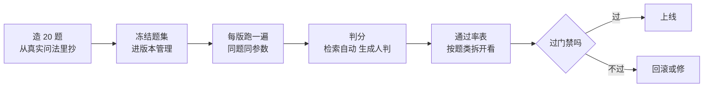

# 05 RAG 评测：造一套自己的考卷

> **一句话结论**：没有固定题集的 RAG 优化全是玄学；20 道题、三个指标、一条门禁，比任何一次 demo 都更能决定这版能不能上。

---

## 一、为什么 PM 要懂这个

周五评审会。工程打开笔记本：「我拿知识库里最常问的 10 个问题试了，10 条全对，可以上。」

会议室里没人反对。因为反对需要理由，而「我看着挺好」不是理由。

一周后数据回来了：

| 指标 | 上线前 | 上线一周 |
|---|---|---|
| 日均提问 | 210 | 1,840 |
| 转人工率 | 18% | 31% |
| 同一问题连问 3 次以上 | 7% | 22% |
| 用户点「没解决」 | 11% | 39% |

复盘那 10 条题：全是工程自己写的、答案全在文档第一段、全是短问句。

用户真实问的是：

> 「我上个月 12 号入职，这个月能休年假吗？之前公司交了 4 年社保，算不算工龄？」

这一句里藏了四件事：入职时间、年假按司龄还是按累计工龄、社保能不能折算、当月是否按比例。答案要跨《考勤管理办法》和《年假实施细则》两份文档。

那 10 条题，一条都覆盖不到。

**这就是本讲的核心论点：人肉试 5 条不算评测，那叫幸存者抽样。** 三个机制在起作用：写题的人知道答案在哪一段，题会不自觉地「指向」那一段；试的人是同事，不好意思说「你这东西不行」；人不会主动去试「知识库里没有的问题」，而那恰恰是最危险的一类。

上线后第一批真实用户会替你完成这次评测。代价是口碑。

---

## 二、机制

评测的机制只有五个动作。难点不在技术，在于**题从哪来、分数谁说了算**。



### 2.1 二十道题怎么配

题不是凑数，是配比：

| 类型 | 题数 | 长什么样 | 想抓什么 |
|---|---|---|---|
| 真实用户问法 | 12（60%） | 从客服记录、搜索日志里原样抄，保留错别字和省略 | 主路径能不能过 |
| 边界与陷阱 | 4（20%） | 带条件、带时间、带例外、两份制度互相冲突 | 切分和组装的问题 |
| 拒答题 | 2（10%） | 知识库里明确没有的（竞品价格、明年政策） | 会不会编 |
| 多跳题 | 2（10%） | 要跨两份以上文档才能答 | 召回能不能覆盖多来源 |

60/20/10/10 是起点，不是标准答案。**如果产品在法务、医疗、报价场景，把拒答题提到 4 道，真实问法降到 10 道。** 拒答题越多，你越安全，但通过率会越难看——这个取舍要提前和老板讲清楚，否则你会在评审会上被质疑「为什么加这么多必错的题」。

每条题必须带三个字段，缺一个这题就废了：

| 字段 | 填什么 | 为什么必须有 |
|---|---|---|
| 用户原话 | 一个字都别改，包括错别字 | 改一个字，你考的就是自己写的题 |
| 标准答案要点 | 2–4 个必须出现的点，不写整段答案 | 判分才有依据，否则全靠感觉 |
| 必须引用的文档 | 文档名 + 条款号/段落号 | 检索评测唯一可自动化的抓手 |

### 2.2 三个指标，每个分 0/1/2

| 指标 | 0 分 | 1 分 | 2 分 | 谁判 | 能自动吗 |
|---|---|---|---|---|---|
| 召回命中率 | 必须引用的文档不在 top-k | 在 top-k，但排在 6–10 位 | 排在前 5 | 工程跑脚本，产品核对 | 能，完全自动 |
| 答案忠实度 | 有编造，或与文档矛盾 | 主结论有依据，细节超纲 | 每句事实都能指回原文 | 产品抽检 30% | 半自动，LLM 逐句比对 |
| 有用性 | 没解决，还误导 | 部分解决，用户还要追问 | 读完直接能用，不转人工 | 产品/业务方 | 不能 |

召回命中率为什么要留 1 分这一档：文档排在第 8 位，做了重排还有救；没做重排，基本等于没召回。**这一档存在的意义，是逼你区分「召回质量」和「排序质量」**——两者的修法完全不同。

拒答题单独判，不走上面这套：拒答或转人工 = 2 分；说「我不确定，建议咨询 HR」= 1 分；**编了一个答案 = 0 分，且一票否决**——拒答题没有「编得挺像」这回事。

### 2.3 一个关键区分：检索评测 vs 生成评测

这是本讲最容易被跳过、也最容易做错的地方。

| | 检索评测 | 生成评测 |
|---|---|---|
| 评什么 | 找得对不对 | 说得对不对 |
| 判据 | 该引用的文档在不在 top-k | 每句事实有没有原文依据 |
| 能不能自动 | 能，脚本跑，结果可复现 | 不能全自动，LLM 当裁判 + 人抽检 |
| 出错的样子 | 稳定、可二分 | 同一个输入跑两次不一样 |
| 产品经理花多少精力 | 主要精力 | 抽检 20–30% |

产品经理该盯检索评测，理由很务实：它可复现、跑得快，你一天能跑十版；生成评测贵、慢、有争议，只能抽样。**把能自动化的部分自动化，把人的时间留给判断。**

用 LLM 当裁判是可以的，但要配两条纪律：一是固定裁判 prompt 和裁判模型版本（换裁判等于换考卷，历史数据全部不可比）；二是每周人工抽检 20–30% 做校准，看裁判有没有系统性偏袒某一版。

### 2.4 一条能落地的流程

20 题表 → 每版跑一遍 → 记通过率 → 定门禁。

| 指标 | 门禁 | 不达标怎么办 |
|---|---|---|
| 召回命中率（top-5） | ≥ 85% | 修切分和查询改写，不许上线 |
| 忠实度 2 分占比 | ≥ 90% | 查上下文组装和拒答阈值 |
| 拒答题 | 0 条编造 | 一票否决，不管其他指标多好 |
| 有用性 2 分占比 | ≥ 70% | 可以上，但排进下一版 |

三个数字为什么长这样：召回 85% 意味着 20 题最多错 3 题，是「用户能忍」的量级；忠实度 90% 是「十句话里最多一句没依据」，再低用户就开始不信；拒答题是 0，因为编造是唯一一种会让用户彻底失去信任的错误。

**起步 20 题就够。** 团队跑顺了再扩到 30–50 题（第 13 讲的 PRD 示例用 30 题：高频 15、边界 10、拒答 5，就是这个比例）。别一上来做 200 题——你会因为维护不动而放弃它，那还不如 20 题跑一年。

**门禁的真正作用不是拦住版本，是让「要不要上」这件事不需要开会吵。**

---

## 三、产品视角：这条技术决定了什么决策

1. **门禁数字按业务容错定，不按行业标杆定。** 内部 FAQ 召回 75% 也能上，因为答错了用户会再问一次；对外报价 95% 也不够，因为错一次就是赔钱。代价：定得松要接客诉，定得严要接排期。
2. **每次只改一处，否则无法归因。** 一版同时换切分、加 rerank、改 prompt，通过率涨了 8 个点，你不知道是哪个起的作用，下一版没法复制。代价：迭代变慢，一版只验一个假设。
3. **题集要冻结，题不能随手改。** 改一道题，历史通过率全部不可比。要加题就新增，别改老题。代价：题集会越滚越大，需要退休机制。
4. **出题的人和跑分的人要分开。** 产品出题（因为产品知道用户在问什么），工程跑分（因为工程能自动化）。同一批人既出题又判分，会不自觉地出「能过的题」。
5. **评测集是资产，不是一次性的活。** 每次线上出现新类型的 bad case，就往里加一道。一年后 20 题会变成 60 题，那是最难被替代的东西。

---

## 四、上手

`demos/05_eval_set.py`（由另一位同事维护）做一件事：**用 10 道题，把「新版是不是好点了」变成两列可以打分的数字。**

题是电商售后的 10 道：耳机拆封能不能退、多少钱包邮、保修多久、发票多久开，第 10 题是「我要投诉你们」——语料里根本没有，专门考兜底。业务和本讲的制度问答不一样，方法一模一样：换成你自己产品的 10 条真实问句就行。版本有两个：v1 是「能跑」的（只做关键词召回、切分粗糙），v2 是「能上线」的（加一次查询改写、多召回几段）。

它按 2.2 节的规则逐题打分，每题三个 0/1/2：

- **召回**：这道题必须出现的关键事实，在取回的段落里出现了几个；
- **忠实**：答案里的句子，能不能原样对回取回的段落（对不上就是编的）；
- **有用**：用户问的几个点，答案覆盖了几个。

然后做三件事：

1. 逐题并排打出 v1 / v2 的三项得分——哪一类题变好了、哪一类没动，一眼看得出来；
2. 汇总成三个百分比，和 2.4 节的门禁（召回 85%、忠实 90%、有用 70%）逐项比一遍，直接给结论：v1 的召回 90% 过关，但忠实只有 80%——它答的部分内容对不回原文，不许上灰度；v2 三项全过，进 5% 灰度、盯住线上兜底率；
3. 挑 Q2 拆开给你看分数为什么差：用户说「我上周买的东西想退回」，文档里写的是「退货」，v1 字面零重叠、一段都没取到，模型只能答一句空话；v2 加了一次同义词改写，从 0/0/0 变成满分。

输出形态大致是这样（示意，不是真实输出）：

```
题   考什么        v1 召回/忠实/有用   v2 召回/忠实/有用
Q1   常识陷阱      2/2/2               2/2/2
Q2   口语 vs 术语  0/0/0               2/2/2
...
汇总：召回 90%→100%   忠实 80%→100%   有用 80%→100%
门禁：v1 卡在忠实 —— 不许上灰度；v2 三项全过 —— 进 5% 灰度
```

一个必须说清的限制：这套判分是规则化的近似——关键词在不在、句子能不能原样找回去。它能抓住「该召回的没召回」「召回到了却没用上」「答案超出上下文」，抓不住「话说得对，但用户不敢照着做」。最后一种只能人抽检，这就是 2.3 节的分工。

这张表里最值钱的信息不是「新版更好」，而是「新版在第 02 题这类口语问法上更好」。**这一个信息比通过率高 20 个点更有用**，因为它告诉你下一版该往哪修。

如果输出和你的预期不一致，改的是脚本的判分逻辑，不是题。题是考卷，判分是阅卷标准，两者都要冻结。

---

## 五、常见误判

**说法一：「准确率 92%，可以上。」**
实际：一个数字把三类题混在一起了，92% 完全可能是「happy path 全对 + 拒答题全编」。怎么验证：按题类拆成四个数字，拒答题单独看。

**说法二：「我拿文档里的句子当考题，它都答对了。」**
实际：你考的是「能不能匹配原句」，不是「能不能回答用户」，用户不会用文档的语言提问。怎么验证：数一下题里几道不含文档原词，低于一半就是自欺。

**说法三：「先测主流程，边界 case 以后再说。」**
实际：上线后第一批客诉永远来自边界，而边界恰恰是切分和组装问题的唯一暴露口。怎么验证：数你的题里带「但是/除了/不超过/需审批」的有几道，0 道等于没测。

**说法四：「5 条够了，我们自己试。」**
实际：5 条里错 1 条就是 20 个百分点，统计上什么都说明不了，而且这 5 条是写的人挑的。怎么验证：找一个没参与开发的人，从客服记录里随机抄 10 条真实提问再跑一遍，通过率会立刻掉一截。

---

## 六、30 分钟练习

先做 10 题版本，别做 20 题。交付两样：

1. **一张 10 行表**：题号 / 用户原话 / 标准答案要点（2–3 点）/ 必须引用的文档 / 类型（真实问法·边界·拒答·多跳）。真实问法必须从真实渠道抄，抄不到就自己当用户，把话说得口语一点、带点错别字。
2. **一行门禁**：写下「召回 ≥ __%、忠实度 ≥ __%、拒答题 0 条编造」，并写一句为什么是这些数——你的业务容错到底在哪。

然后做一件更重要的事：拿当前版本，手工判一遍这 10 题。你会发现两件事——通过率比你想的低，以及错的几题集中在同一个类型上。**那个类型就是下一版该修的地方。**

---

## 90 秒话术

> 「没有评测集的 RAG 优化全是玄学。人肉试 5 条不叫评测，叫幸存者抽样——题是你写的，答案在哪你早知道。
>
> 我的做法是 20 题：60% 从客服记录原样抄，20% 边界陷阱，10% 拒答，10% 多跳。每题必带答案要点和必须引用的文档。
>
> 三个指标分开看：召回命中率可自动化，产品盯；忠实度靠 LLM 裁判加人工抽检；拒答题一票否决，编一条就不许上。门禁定了，『这版能不能上』就不用开会吵。」

---

> 想读源码：`explodinggradients/ragas` —— 看它把「忠实度」「上下文召回」拆成了哪几个可计算的指标，以及它为什么仍然建议人工抽检。

**下一讲** → [06 记忆与上下文预算](06-记忆与上下文预算.md)
