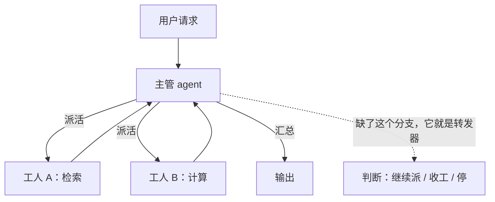

# 07 多智能体：什么时候才值得

> **一句话结论**：多智能体只在三种情况下值得——**上下文必须隔离、子任务可以并行、需要不同角色的冲突**。三条都不满足，单 Agent + 好工具更便宜、更稳、更好查。

## 一、为什么 PM 要懂这个

你们做了一个「行业研究报告助手」，四个 agent：检索、分析、写作、审校。演示很好看——每一步都有角色名，输出像模像样。

上线一个月，你算了一笔账：

| 版本 | 单份成本 | 耗时 | 20 份人工盲评 |
|---|---:|---:|---:|
| 单 Agent（一个循环 + 五个工具） | 1.4 元 | 3 分 10 秒 | 7.8 / 10 |
| 四 Agent（检索 / 分析 / 写作 / 审校） | 6.2 元 | 11 分（并行后 7 分） | 8.0 / 10 |

贵 4.4 倍，质量高 0.2 分。这 0.2 分还主要来自「结构更完整」，不是「更准」。

真正的事故在第三周被发现：一份报告引用的政策条款，是两年前作废的版本。追下去，链条是这样的——检索 agent 抓了一篇旧文，分析 agent 把它当有效依据写进结论，写作 agent 把它写得很有说服力，审校 agent 批注「引用格式正确」。

**四个 agent 都完成了自己的工作，错误却一路绿灯。** 因为审校 agent 只看到写作的输出，看不到检索的原文；它审的是文风，不是事实。

这就是多智能体最典型的代价：**它不会让系统更聪明，它会让错误也有分工。**

评审会上老板问过一句：「四个 agent 各自都靠谱吧？」工程答：「都靠谱，每一步都过。」这句对话后来被原样贴进了复盘文档——**每个环节都通过，不等于整条链正确。**

## 二、机制

### 三条判据：满足几条，才拆几个

拆不拆，只问三个问题，每个问题都有明确的「是」的标准：

| 判据 | 「是」的标准 | 不满足却硬拆的后果 |
|---|---|---|
| 上下文是否需要隔离 | 两个子任务各自的资料量都接近窗口上限，混在一起会互相挤掉 | 只是角色名不同、资料是同一份，拆完多花三倍 token |
| 子任务是否可并行 | 两条流之间没有依赖，可以同时开始 | 后一步必须看前一步结果，拆完只多了转述损耗 |
| 是否需要不同角色的冲突 | 需要「一个人写、另一个人专门挑错」，且挑错的人看得到原文 | 三个 agent 互相点头，等于一个人自言自语分三段 |

一条都不满足 → 单 Agent + 好工具。三条全满足 → 拆，收益很实在（时间省一半、错误有人拦）。

一个更狠的自检：**你能不能用一句话说清「这两个 agent 之间传的是什么」？** 说不清，说明你没隔离出真正的子任务，只是把一次调用切成了几段。

### 四种拓扑

| 拓扑 | 数据怎么流 | 什么时候用 | 什么时候是灾难 |
|---|---|---|---|
| Pipeline（流水线） | A 的输出是 B 的输入，串行 | 阶段清晰、每段可单独评测（抓取 → 抽取 → 成文） | 某段错误被下游「加工得更可信」；串行延迟叠加 |
| Hub-Spoke（主管-工人） | 主管派活、收结果、再派 | 任务可拆成互不依赖的小块，需要汇总 | 主管只会转发；工人之间要互看结果时全靠主管转述 |
| Blackboard（共享黑板） | 所有 agent 读写同一块共享状态 | 需要长期协作、信息要沉淀（排查、诊断） | 没有写入规范，黑板变成垃圾场；后写的覆盖先写的 |
| State Machine（阶段状态机） | 按阶段推进，每阶段固定角色 | 流程有明确阶段和门禁（起草 → 法务 → 定稿） | 阶段划分不清，agent 在阶段间来回跳，永远到不了终态 |

多数线上系统是 Pipeline + 一段 Hub-Spoke 的混合：主干串行，某一段内部并行。

### 一张图：Hub-Spoke 怎么退化成转发器

图里那条虚线是分水岭。主管如果只有「派活 → 收结果 → 汇总」，它没有任何额外判断力，你付的是一个 agent 的钱，买了一个 `for` 循环。真正的主管要有三件事：**拆活的标准、验收的标准、叫停的标准**——这三件都是你写进 prompt 和代码的，不是它自己长出来的。

### 代价：四笔账，都是乘法

| 代价 | 内部发生了什么 | 量级 |
|---|---|---|
| token | 每个 agent 有自己的系统提示和上下文，同一份材料被反复读 | 3–8 倍，不是 N 倍 |
| 调试 | 错误在 agent 之间传染，每传一跳都可能被「加工得更可信」 | 定位时间是单 agent 的 N 倍 |
| 延迟 | 只有并行段省时间；串行段和「来回问」都在加时间 | 不可控，取决于主管几轮问清 |
| 评测 | 端到端只能告诉你「错了」，要定位得按 agent 建评测集 | 工作量 ×N，还要存每一跳的输入输出 |

第三行常被忽略：**多智能体的延迟下限是「最慢那条链」，不是平均值。** 主管来回问三轮，每轮都是一次完整的模型调用，用户等的是三轮之和。

### 一个类比：一个人干，还是叫一个小组

一个人干：他脑子里有全部上下文，做得快，但容易被自己的假设带偏，且一次只能干一件。

叫一个小组：能同时查三份材料（并行），有人专门唱反调（冲突），但每开一次会信息就损耗一次（转述），而且组里最响的那个人（主管）往往只是把话转给下一个人。

**判断标准不是「这事复杂不复杂」，是「这事需不需要几个人各自拿着一部分信息、并且互相看不见对方的信息」。** 需要，才叫小组；不需要，叫小组只是多开了几个会。

### 反模式

- **为了「看起来像智能体系统」而拆角色。** 产品页写「五个专家协同」，代码里是五次串行调用，每次只换了一句系统提示。
- **两个 agent 互相客套。** 「请您审阅」「感谢，已修订」——两轮过去内容没变，token 翻倍。
- **主管只会转发。** 它把用户的话原样发给工人，再把工人的话原样拼起来；没有拆活、没有验收、没有叫停。
- **共享黑板没有写入规范。** 后写的覆盖先写的，谁最后跑完谁说了算，出了问题查不到是谁改的。

## 三、产品视角：这条技术决定了什么决策

1. **卖点写成「可解释」和「更快」，不要写「更聪明」。** 每一步有角色署名、有输入输出，这是真价值；说「更聪明」而上线后被用户发现不如单 agent，翻车最快。代价：署名要真到「谁查的、谁核的」，不能只是给一次调用贴三个名字。
2. **按「上下文边界」拆角色，不按组织架构拆。** 人类团队的产品/运营/法务分工靠的是职责，不是信息隔离；照这个拆，通常拆出三份重复的 prompt。代价：真正的边界要工程帮你画信息流，产品一个人画不出来。
3. **并行只在「互不依赖」的段存在，收益要单独核算。** 报告类、批量审核类能省 40%–60% 时间；对话类基本省不了。代价：并行要处理结果合并，冲突裁决规则得你定。
4. **把 per-agent 评测写进排期。** 没有它，出事只能整段重跑，也无法回答「是哪个 agent 错的」。代价：评测工作量翻几倍，但这是多智能体唯一能规模化的前提。
5. **能用一个 agent + 三个工具解决的，别用三个 agent。** 代价：工具方案在「需要独立长上下文」时会撞墙，那时候再拆——撞墙是有信号的（上下文被挤爆、工具返回被截断）。

## 四、上手

**纸上推演（15 分钟）**：给你的系统画一张信息流图。

1. 列出 5–7 个步骤，每步写清「输入是什么、输出是什么」，写到字段级，不写「一些资料」。
2. 在每两个相邻步骤之间标一个字母：**T** 表示传的是原文/原始数据，**C** 表示传的是结论/摘要。
3. 只有标 **C** 的接缝才是候选拆分点——传结论意味着下游不需要上游的全部上下文，隔离才有意义。
4. 再看这些候选点之间能不能并行。能并行的才值得拆。

交付物：一张标了 T/C 的流程图，加一句话结论（拆几个、哪几个、并行哪几段）。

**自检**：如果你的图上一个 C 都没有（每步都在传原文），那你不需要多智能体，你需要的是把上下文压小（第 06 讲）。

## 五、常见误判（反面清单）

1. **「多智能体更像人、更高级。」**
   实际：它是工程手段，不是能力等级；多数情况下只是把一次调用拆成三次，还加了转述损耗。
   验证：把 agent 数从 4 减到 1，看质量掉多少；掉得很少，多出来的就是表演。

2. **「主管 agent 会协调。」**
   实际：多数实现里主管只做转发和汇总，真正的协调逻辑是你写在代码里的路由。
   验证：看主管的提示里有没有「什么情况下不往下派」的规则；没有，它就是转发器。

3. **「多个 agent 交叉验证更准。」**
   实际：如果它们读同一份资料、用同一个模型，错误是相关的，投票不会变准。
   验证：让两个 agent 各写「你的依据是哪一条原文」；依据相同，投票无意义。

4. **「拆开更好调试。」**
   实际：拆开更好定位，但更难复现；单 agent 的 trace 是一条线，多 agent 是一棵树。
   验证：出事时能否 10 分钟内指出「哪个 agent 的哪一步」；不能，就是没做 per-agent trace。

## 六、30 分钟练习

交付物：一张「拆 / 不拆」决策单。

1. 用 10 分钟画上面那张 T/C 信息流图。
2. 用 10 分钟按三条判据打分（每条 0 / 1 / 2），写下「拆几个」。
3. 用 10 分钟回答两个问题：拆完之后，哪个 agent 的产出要能单独评测？如果它错了，谁会先发现？

第 3 问答不出来，就先别拆——那意味着你还没有能力发现它的错，只是把它藏得更深了。

## 90 秒话术

> 「多智能体我不因为看起来高级就上。只问三个问题：上下文是否必须隔离、子任务能否并行、是否需要一个人专门挑错。三条都不满足，单 Agent 加几个好工具更便宜也更稳。
>
> 我复盘过一个四 agent 报告助手：贵 4.4 倍，盲评只高 0.2 分，一条作废政策从检索传到成稿，四个都完成了自己的工作。它不会让系统更聪明，只会让错误也有分工。
>
> 它的价值是可解释和并行，不在更聪明。」

> 想读源码：`microsoft/autogen`（看多 agent 会话怎么编排，重点看一条消息在 agent 之间怎么传）；`crewAIInc/crewAI`（看「角色 + 任务」这套抽象怎么落到代码，以及它默认的交接方式）。

**下一讲** → [08 成本与模型路由](08-成本与模型路由.md)
