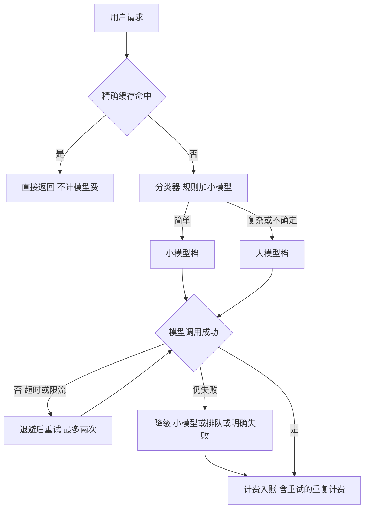

# 08 成本与模型路由

> **一句话结论**：Agent 的成本不是一个单价，是一个**乘出来的结构**——轮次、上下文长度、重试率，任何一项翻倍，账单就翻倍。模型路由的本质是「让简单问题不花复杂问题的钱」，代价是你得为判错的那部分买单。

---

## 一、为什么 PM 要懂这个

上线第 30 天，财务把账单转给你：**4.2 万**。立项时你按 demo 估的是 8000。

老板把你叫过去，对话大概是这样的：

> 老板：这个功能一个月烧多少？
>
> 你：demo 每次调用 2 分钱，一天 2 万次，一个月一万二。
>
> 老板：那为什么账单是四万二？
>
> 你：……可能是重试？

三个原因叠在一起，每一个你当时都没算：

1. **demo 是单轮，线上平均 3 轮。** 第 3 轮要把前两轮的问答全带上，输入不是 1 份，是 1+2+3 份。
2. **demo 上下文 800 token，线上是 4k。** 6 条检索片段 + 5 轮历史 + 2k 系统提示。
3. **5% 的请求重试了。** 重试是把**整段上下文**再发一遍，不是从断点续传。

你估的是「一次调用」，账单算的是「一次会话」。这两个词的差距，就是 8000 变 4.2 万的全部原因——这一讲要给你的，是能在会上当场算出来的那张纸。

---

## 二、机制

### 成本公式

```text
单次会话成本 =（输入 token × 输入单价 + 输出 token × 输出单价）× 轮次 ×（1 + 重试率）
```

式子里有**三个乘法**：你以为在优化单价，其实轮次和上下文各翻一倍，效果和单价翻四倍一样。

### 一个算例，两档单价

客服场景：日均 2 万次会话，每次 3 轮，每轮 4k 输入、500 输出。单价为示例，按你的业务改。

| 项目 | 小模型档 | 大模型档 |
|---|---|---|
| 输入单价 | ¥1 / 百万 token | ¥20 / 百万 token |
| 输出单价 | ¥2 / 百万 token | ¥60 / 百万 token |
| 每轮 4k 输入 + 500 输出 | ¥0.005 | ¥0.11 |
| 一次会话 3 轮 | ¥0.015 | ¥0.33 |
| 日均 2 万次 | ¥300 | ¥6600 |
| 月成本 30 天 | ¥9000 | ¥198000 |
| 加 5% 重试 | ¥9450 | ¥207900 |

**差 22 倍。** 所以「要不要上大模型」从来不是能力问题，是「哪些问题值得付 22 倍」。这就是模型路由存在的全部理由。

还有个反直觉的点：输出单价是输入的 2–3 倍，但输入量是输出的 8 倍，所以**输入占了总成本的八成**。结论很直接——先治上下文，再治模型档位；反过来做，你会花很大力气换来一点点。

### 三种省钱手段，和它们各自的代价

| 手段 | 怎么省 | 省多少（示例，按你的业务改） | 代价 | 什么时候值得 |
|---|---|---|---|---|
| 模型路由 | 先分类，简单问题走便宜档 | 60–80% 流量降档，省 50–70% | 多一个分类器；误路由直接伤体验 | 问题难度分布明显双峰 |
| 缓存 | 相同或相近问题直接返回 | FAQ 命中 30–40% | 语义缓存会误命中；政策更新要失效 | 问题重复率高（客服、制度问答） |
| 上下文瘦身 | 少带历史、少取检索片段 | 输入砍半即成本砍半 | 变笨：指代丢失、证据不足 | 输入 token 占成本七成以上 |

**路由**用三级最稳：规则（正则、问题长度、有没有带订单号）→ 小模型当分类器（多一次调用，加 200–300ms）→ 兜底默认走大模型。误判的代价要算清：100 次里错 8 次，其中 2 次答错转人工，人工按 ¥8/次算，每次会话多摊 ¥0.16——差不多把省下的 ¥0.2 吃光（示例数字）。**所以路由的收益全在「误判率低于 5%」这条线上**，不在分类器多聪明。

**缓存**分两种。精确缓存（同问同答）几乎无风险；语义缓存会误命中：用户问「换货政策」，向量检索把「退货政策」判成同一句（相似度 0.94），于是给了他退货的答案。做法三条一起上：相似度阈值卡到 0.95 以上、只对事实型 FAQ 开白名单、金额与时效类目直接禁用。缓存 key 还要带资料版本号，否则政策一改，旧答案会继续发一个月。

**上下文瘦身**最容易被低估。历史从 10 轮压到 3 轮加一句摘要，检索从 top 8 降到 top 4，输入直接砍一半。代价是可描述的具体现象：用户说「就那个」，指代找不到了；多跳问题少一条证据，答一半。判断线是先砍两块无损的——重复的系统提示、检索回来但没被引用的片段，这两块通常占 20–30%。



**一个类比**：成本像打车。车型是模型档位，里程是轮次和上下文，绕路是重试。你不会为三公里叫专车，也不会让赶飞机的客户拼车——路由就是那个「看人下菜」的动作；缓存是「这条路昨天走过，按老路线走」；上下文瘦身是「少带行李」。

### 降级：模型挂了，用户看到什么

这是**产品写的那句话**，不是工程兜底。三条路，选哪条取决于答错的代价。

| 策略 | 用户看到 | 适合 | 代价 |
|---|---|---|---|
| 静默降级到小模型 | 「当前为快速模式，复杂问题可转人工」 | 问题简单、答错代价低 | 必须告知；不告知，用户会以为是 bug |
| 排队重试 | 「正在重试，预计 20 秒」并给进度 | 后台任务、非即时场景 | 等待中流失，必须能给取消 |
| 明确失败 | 「现在无法回答」+ 人工入口 + 保留已输入内容 | 金额、医疗、合规这类答错要出事的场景 | 转人工有成本，但比答错便宜 |

三条都要落一个数：**降级率**。它从 2% 跳到 15%，是事故最早的信号，比用户投诉早半小时。

### 成本对账：为什么你算的和账单总对不上

| 你以为 | 实际 | 差多少（示例，按你的业务改） |
|---|---|---|
| 字符数 ÷ 1.5 = token | 中文 1 字约 1–2 token，英文 1 词约 1.3 | 估低 20–40% |
| 一次调用计一次费 | 重试把整段上下文再发一遍 | 5% 重试即 +5%，带长上下文可到 +8% |
| 系统提示只算一次 | 每轮都带，3 轮就是 3 倍 | 2k 系统提示 × 3 轮 = 6k，占 4k/轮的 50% |

对账方法只有一条：**别拿本地估算去对账，拿 `账单 token ÷ 成功会话数` 反推真实单会话成本**，再乘预估量。差异超过 15%，先查重试和系统提示，这两项占偏差的大头。

预算告警挂两个数：日消耗速率（连续 2 小时超过 日预算/24×1.5 就报）和单会话成本 P95。别只挂总额——总额是月底才知道的事，P95 是今天就能知道的事。

---

## 三、产品视角：这条技术决定了什么决策

**1. 预算按「会话」报，不按「调用」报。**
判断标准：你能不能说出一次完整会话成本的 P50 和 P95。说不出来，你所有的成本承诺都是猜的。代价：要工程加埋点，大约一周。

**2. 降级文案是产品资产。**
判断标准：模型超时那一刻，用户看到的那句话有没有写清「现在是什么状态、他可以做什么」。代价：多一轮设计评审，换来的是投诉少一半。

**3. 语义缓存按类目白名单开，不做全局开关。**
判断标准：这个类目答错的代价，是否大于省下的钱。代价：缓存命中率从 40% 掉到 25%，省得少但睡得着。

**4. 判断要不要路由，看分布不看均值。**
判断标准：把最近 500 条真实问题按难度分三桶，如果简单问题占 60% 以上，路由就值得做。代价：需要一次人工标注，两天。

---

## 四、上手

不用写代码，拿一张纸：

1. 写下三个数：日均会话数、平均轮次、每轮输入 token。第三个问工程要；要不到就用 `检索条数 × 500 + 历史轮次 × 300 + 系统提示长度` 估。
2. 套公式，用小模型和大模型两档单价各算一遍月成本。
3. 加一行：把 60% 的简单问题路由到小模型，月成本变成多少。
4. 再算一步：误路由率多少时，省下的钱会被转人工的成本吃平。这个点就是你路由方案的生死线。

想看「重试怎么变成账单」，跑 `demos/04_breaker_retry.py`。它把同一场故障（下游连续 9 秒不可用）用三种策略各跑一遍：不重试、重试 3 次、重试加熔断加降级。输出里有一列叫「打到下游」——重试 3 次那一版把它做到不重试的 2.3 倍，账单上多出来的钱就是这个倍数的影子；带熔断那一版只让下游承了不到三成的调用，剩下的用兜底文案打发。改 `OUTAGE` 的时长、改重试次数，倍数跟着变。**这就是为什么「重试率 5%」落到账单上从来不是 5%。**

---

## 五、常见误判（反面清单）

**「我们用小模型就够了。」**
实际：小模型不是全线等价，它在长上下文和多跳问题上掉得最狠。
怎么验证：同一套 20 题跑两档，按「简单 / 多跳 / 带数字计算」分桶看通过率，别看总分。

**「加个缓存就能省一半。」**
实际：缓存省的是「重复问题」，而你的流量重复率可能只有 12%。
怎么验证：抽 1000 条真实会话，去重后数一下独立问题有多少个。

**「重试不花钱，反正那次失败了。」**
实际：多数供应商按 token 计费，失败的调用照样收钱，且重试放大了流量。
怎么验证：让工程拉出「失败请求占比」和「重试产生的 token 占比」，后者常常是前者的 2–3 倍。

**「降级是工程的事，他们加个兜底就行。」**
实际：兜底返回什么、用户还能不能完成任务，是产品定义。
怎么验证：手动把大模型关掉，自己完整走一遍主流程，看能不能走完。

---

## 六、30 分钟练习

交付一张「成本卡」，一页纸，四行：

1. 我的功能：日均会话 ___ 次，平均 ___ 轮，每轮输入 ___ token。
2. 两档月成本：小模型 ¥___，大模型 ¥___，差 ___ 倍。
3. 一条路由规则（写成「如果……就走小模型」的句子），以及你能接受的误路由率。
4. 一条降级文案，20 字以内，要包含「现在怎么了」和「你可以做什么」。

做完把这张纸发给工程，问他两个数对不对。**他改的那两个数，就是你这次练习真正的产出。**

---

## 90 秒话术

> 「Agent 的成本不是单价，是乘出来的：token 乘单价，再乘轮次，再乘一加重试率。同样一次会话，小模型档和大模型档能差二十倍，所以成本决策不是选模型，是选哪些问题值得用贵的。
>
> 省钱三条路——路由、缓存、上下文瘦身，每条都有代价：路由要背误路由，语义缓存会误命中，瘦身上下文会让它变笨。我不问『能不能更便宜』，我问『便宜下来的那部分，答错率涨了多少』。
>
> 还有一句话必须产品自己写：模型挂了的时候，用户看到什么。」

---

> 想读源码：`BerriAI/litellm` → `litellm/router.py` 与 `model_prices_and_context_window.json`（看「模型路由 + 失败回退 + 价格表」这三件事在工程里是怎么被放在一起的）。

**下一讲** → [09 稳定性与可观测](09-稳定性与可观测.md)：便宜和快之外，第三个必须谈的指标是「挂了怎么办」。
