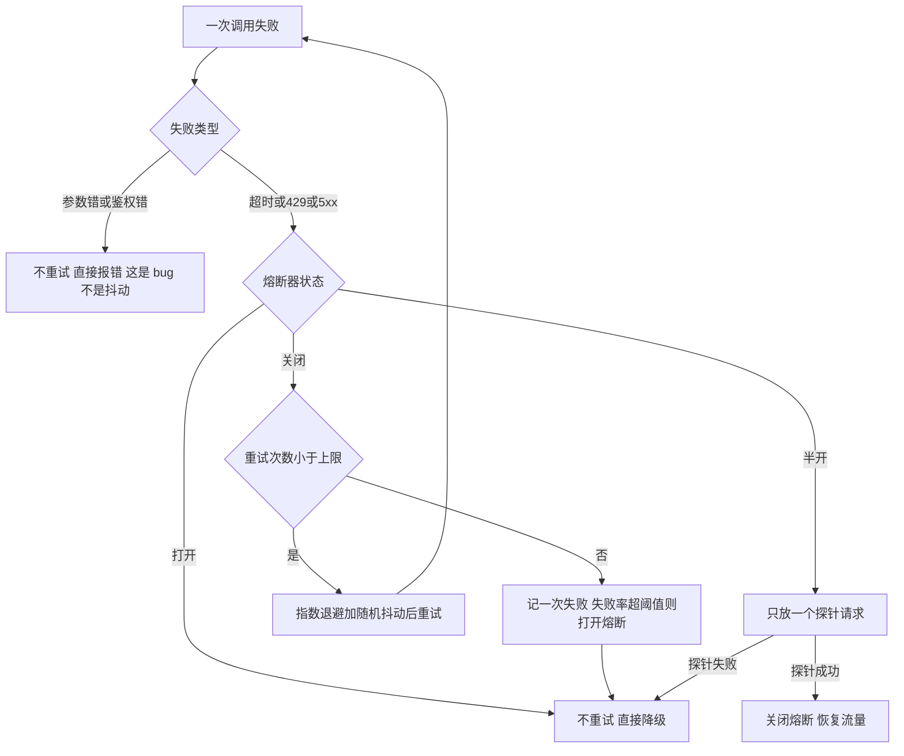

# 09 稳定性与可观测

> **一句话结论**：稳定性不是「不出故障」，是**故障发生时系统还能给出一个可接受的答案**。重试治抖动、熔断治持续故障、降级治不可用，三者必须一起上；而 trace 是你在复盘会上唯一能拿出的证据。

---

## 一、为什么 PM 要懂这个

早上 9:00，客服 Agent 挂了 20 分钟。

复盘会上，工程说：「我们加了三次重试，按理不该挂。」

你问了一句：「重试打到哪儿去了？」

沉默了几秒，他说：「还是打到那个接口。」

这就是问题所在：**模型供应商当时已经在限流，你的重试把请求又塞了回去**。重试不是「再试一次」，是「在对方已经撑不住的时候，再多给它三倍压力」。

第二个场景更能说明「可观测」值多少钱。

一周后用户投诉：「它给我编了一个运单号。」你转给工程，工程说「复现不了」。于是这件事只能以一句「我们会持续优化」结束——**没有 trace，你连道歉都道不准**。

有 trace 的话，同一件事三分钟就能看完：检索返回 0 条 → 模型没有拒答 → 自己生成了一个像运单号的字符串 → 直接输出。结论不是「模型不稳定」，是「检索空结果的兜底没写」。

这一讲给你两个东西：一张「什么时候用重试、什么时候用熔断」的决策图，和一份「上线前必须问工程的 6 个问题」。

---

## 二、机制

### 三个机制，治的是三种不同的病

| 机制 | 治什么 | 什么时候触发 | 代价 | 谁定参数 |
|---|---|---|---|---|
| 重试 | 偶发抖动（1% 的网络错误、一次瞬时限流） | 超时、429、5xx | 把流量放大 N 倍 | 工程定次数，产品定「最多让用户等多久」 |
| 熔断 | 持续故障（对方已经不行了） | 滑动窗口内失败率超阈值 | 一段时间内功能直接不可用 | 产品定「宁可不可用，也不给错答案」的边界 |
| 降级 | 已经不可用 | 熔断打开，或超时预算耗尽 | 体验打折 | 产品写文案和兜底路径 |

三者的关系是**串联**的：先重试，重试撑不住就熔断，熔断打开就降级。顺序反了都不行——先降级会让偶发抖动也变成功能缺失，只重试不熔断会雪崩。

### 重试为什么必须配熔断

给一组数（示例，按你的业务改）：峰值 1 万 QPS 打到模型接口，失败率 30%，重试 3 次。你以为发出去的是 1 万，实际是：

```text
1 万 ×（1 + 30% × 3）= 1.9 万 QPS
```

如果失败率涨到 70%，就是 `1 万 ×（1 + 70% × 3）= 3.1 万`——最坏情况下接近 4 万 QPS。而供应商给你的配额可能是 1.2 万。**你用一个「提高成功率」的机制，把对方的过载放大了 3 倍**，于是 429 更多、重试更多，20 分钟都出不来。

你的业务可能只有 200 QPS，比例完全一样：200 变 800，一样打穿。

两个补丁，缺一不可：

- **指数退避加随机抖动**。不抖动的话，一千个请求会在同一秒失败、同一秒等待、同一秒重试，形成第二波尖峰。
- **全局重试预算**。所有重试请求加起来不超过总请求的 10%，超了就不许再重试。这个阀门比「每个请求重试 3 次」重要得多，因为它限制的是**总量**，不是单次。

还有一条红线：**只有幂等的操作才能自动重试**。查物流可以重试，创建订单、发券、扣款不行——重试一次就是两次副作用。如果工程对写操作也开了自动重试，你要让他改成「先查状态，再决定要不要重发」；否则用户被扣两次钱这件事，通常要到月底财务对账才会被发现。

再补一句区分：429 的意思是「你太快了」，5xx 的意思是「我坏了」。前者该退避加降配额，熔断反而会把本来能用的功能关掉；后者才该进熔断。**把这两种错混在一个失败率里算，阈值永远调不准。**



**一个类比**：重试是「电话没接通再拨一次」；熔断是「对方一直占线，你就别再拨了，过五分钟再试一次」；降级是「干脆发条短信，别打电话了」。没有熔断的重试，等于占线时连拨三十次——你自己手酸，对方更接不进来。

### 一次请求应该被拆成哪些 span

trace 就是把一次请求的每一段耗时和结果记下来。产品不需要看全量，只需要知道**每一段出问题时是什么现象**。

| span | 产品该关心的指标 | 这个指标异常说明什么 |
|---|---|---|
| 路由 | 各档分流比例、分类耗时 P95 | 分类器退化，全走大模型，成本会先炸 |
| 检索 | 空结果率、top1 相似度分布、耗时 | 空结果率高 = 知识库缺内容，或查询改写坏了 |
| 模型 | 首 token 延迟 P95、失败率、token 数 | 失败率突增是供应商问题；token 突增是上下文泄漏 |
| 工具 | 调用成功率、参数错误率、超时率 | 参数错误率高 = 工具描述写坏了，这是产品文档问题 |
| 重试 | 重试率、重试成功率 | 重试成功率高是抖动；低说明是持续故障，该熔断了 |
| 降级 | 降级率、降级后任务完成率 | 降级率高是容量不足；完成率低说明降级方案没用 |
| 计费 | 单会话成本 P95 | 成本异常常常先于用户投诉出现 |

这张表可以直接拿去问工程：「这七个 span，我们现在有几个？」大多数团队只有「模型」和「总耗时」两个。

### 投诉来了，按这个顺序看

拿到 trace 不要从头读，按「越靠后越可能是原因」的顺序看四眼：

1. **有没有输出？** 没有，是链路断了（模型超时、熔断打开），和内容质量无关。
2. **检索回来几条？** 0 条，问题在知识库或查询改写，不在模型。
3. **工具有没有报错？** 报错但模型仍然回答了，说明兜底没写，模型在编。
4. **是不是降级了？** 降级到小模型，答案变浅是预期行为，不是 bug。

四眼看下来，九成的「它乱答」都能落到具体一段。剩下的那一成，才是模型能力问题——而这一成，往往也是最贵的。

### 降级不是一个开关，是四档

一档换小模型（答得浅一点），二档砍检索条数与历史（记不住前文），三档只答缓存里的 FAQ（只能答常见问题），四档直接转人工（换人服务）。**产品要做的就是给这四档各写一句话**——写不出来，说明降级在线上是黑箱，用户遇到的是「它突然变蠢了」，而不是「它正在降级」。

---

## 三、产品视角：这条技术决定了什么决策

**1. trace 是产品经理的取证工具。**
判断标准：给你一个用户投诉的会话 ID，你能否在 5 分钟内看出是哪一段出的问题。代价：trace 存 30 天的存储成本，加上手机号、地址这类字段的脱敏改造。

**2. 可用性口径必须写清「降级算不算可用」。**
判断标准：SLA 里的「可用」，是否包含「降级后仍能完成任务」。如果降级后只能返回一句「请稍后再试」，那它不该算可用。代价：对外承诺变保守，销售会不高兴。

**3. 告警挂在用户可感知的指标上，不挂在机器指标上。**
判断标准：这个指标变了，用户会不会感知到。CPU 90% 用户无感，任务完成率掉 3 个点用户全都能感知。代价：要接产品埋点，两周。

**4. 每条降级路径都要有出口。**
判断标准：降级发生时，用户有没有「下一步动作」——转人工、稍后重试、保留已输入内容。代价：人工坐席成本，但比用户在页面上干瞪眼便宜。

### 上线前必须问工程的 6 个问题

| # | 问什么 | 为什么问 |
|---|---|---|
| 1 | 模型调用超时设几秒？超时后用户看到什么？ | 超时值决定降级频率，那句话决定体验 |
| 2 | 重试几次、退避多久、有没有随机抖动？ | 没抖动就是同步重试，会有第二波尖峰 |
| 3 | 熔断阈值多少、打开后多久探测、谁能手动恢复？ | 阈值太低会频繁误熔断，太高等于没有 |
| 4 | 一次请求有几个 span，能不能按会话 ID 查？ | 决定了你投诉时能不能定位 |
| 5 | 检索返回空的时候，是拒答还是让模型自由发挥？ | 这是幻觉最主要的来源 |
| 6 | 单次成本上限和日预算告警线是多少，超了自动做什么？ | 成本事故和稳定性事故是同一类事 |

另外 6 条在 `templates/上线前12问.md` 里，按「它什么时候会停下来 / 它凭什么这么说 / 出事了怎么知道 / 能不能上」四组排好，每一问都配了「听到什么算过关」和「听到什么算没人管」。上面这张表是它的子集——过一遍 12 问，你会发现自己少问了「同一个工具被重复调用怎么办」和「出了编造事故多久能止血」。**你可以只记住这 6 条，但你要知道还有 6 条。**

---

## 四、上手

先写一张「故障剧本」，四行就够。这是产品交付物，不是工程文档。

| 故障 | 系统应该做什么 | 用户看到什么 | 谁被通知 |
|---|---|---|---|
| 模型超时 30 秒 | 重试 1 次，仍失败则降档 | 「正在用快速模式回答」 | 值班工程 |
| 供应商限流 429 | 熔断打开，转排队或明确失败 | 「当前咨询量大，建议转人工」 | 产品 + 工程 |
| 工具返回 500 | 不重试工具，说明查不到 | 「物流信息暂时查不到，可稍后再试」 | 工程 |
| 检索 0 条 | 拒答并转人工，不许自由生成 | 「这个问题我帮你转人工」 | 内容运营 |

写完检查一件事：**每一行的「用户看到什么」，是不是一句人话**。写不出来，说明这条降级路径在线上根本不存在。

想看状态机怎么跑，跑 `demos/04_breaker_retry.py`。它把同一场故障（下游连续 9 秒不可用）用三种策略各跑一遍：不重试、重试 3 次、重试加熔断加降级。输出一张五列的表——成功、失败、打到下游、P95、降级兜底。重点不是谁成功率最高，是后三列：重试 3 次那一版的成功率最高，代价是「打到下游」翻了一倍多；带熔断那一版成功率低一点，但下游只承了不到三成的调用，还有一批用户 0.4 秒内拿到了兜底，P95 是 0.81 秒。它会把 `closed → open → half_open → closed` 的每次迁移都打印出来，最后问你三个要写进 PRD 的数：熔断阈值、冷却时间、降级文案。

---

## 五、常见误判（反面清单）

**「加重试就稳了。」**
实际：重试治抖动，不治故障；对已经过载的服务重试，是把小故障放大成全站雪崩。
怎么验证：把下游失败率设成 100%，看请求量是原来的几倍。

**「有日志就等于可观测。」**
实际：日志是文本，trace 是结构。你要的是「按一次请求把所有环节串起来」，不是「grep 一个订单号」。
怎么验证：给工程一个用户投诉的时间点，计时看他多久能定位到具体哪一段。

**「熔断打开就是事故。」**
实际：熔断打开说明保护生效了。真正的指标是「一周打开几次、每次开多久」，不是「有没有打开过」。
怎么验证：拉一周的熔断记录，看打开时长中位数。

**「降级就是返回一句兜底话术。」**
实际：兜底话术不完成任务，等于软失败，用户还是会走。
怎么验证：把大模型强制关掉，自己走一遍主任务，看能不能走完。

---

## 六、30 分钟练习

交付一张 A4 的「故障剧本 + 取证清单」：

1. 上面那张四行的故障剧本，按你自己的功能改写，四行都要填满。
2. 给每一行补一列：**这条降级会不会被记进 trace**。不记，就等于没发生。
3. 写下你现在能从工程那里拿到的 span 有哪几个，缺哪几个。
4. 给「用户投诉」写一条内部流程：从收到投诉到定位到 span，一共几步、谁做、多久。

第 3 步的答案通常会很难看——**那就是你下一次评审要提的需求**。

---

## 90 秒话术

> 「稳定性不是不出故障，是故障发生时还能给出一个可接受的答案。重试治偶发抖动、熔断治持续故障、降级治已经不可用，顺序不能反——供应商限流的时候，你重试三次就是把过载放大三倍。
>
> trace 是产品经理的取证工具。用户说『它乱答』，没有 trace 你只能复现或者道歉；有 trace 你能一眼看出是检索没召回、工具报错，还是降级到了小模型。
>
> 上线前我固定问六个问题，第一个是：超时的时候，用户看到哪句话。」

---

> 想读源码：`BerriAI/litellm` → `litellm/router.py`（只看 `num_retries`、`allowed_fails`、`cooldown_time` 三个参数怎么组合成「重试 + 熔断」），以及 `open-telemetry/semantic-conventions` 的 `docs/gen-ai/`（看一次模型调用被规定要记哪些字段）。

**下一讲** → [10 幻觉三层治理](../04-质量/10-幻觉三层治理.md)：稳住了之后，下一个问题是「它说的是真的吗」。
