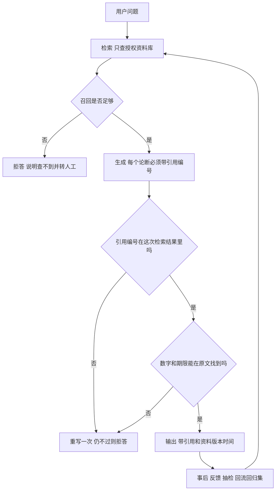

# 10 幻觉三层治理

> **一句话结论**：幻觉不是一个问题，是**三种病**——该知道的不知道、知道但过期了、没依据也敢说。三种病的药完全不同。你用一个「改 prompt」去治三种病，就是这一讲要拦住的错误。

---

## 一、为什么 PM 要懂这个

保险条款问答上线第 3 天，用户问：「住院津贴的等待期是多久？」

Agent 答：「30 天。」还带了个引用角标 [2]。

条款写的是 **90 天**。用户在第 31 天住院，申请被拒，投诉到监管平台。复盘时打开那条引用——[2] 指向的是「等待期定义」那一段，里面根本没出现 30 天这个数字。30 天来自另一个产品的条款，检索时一起被捞了上来。

这件事里有三个独立的错误，很多团队只会看见一个：

1. **资料过期**：库里同时有旧版和另一款产品的条款，没有版本隔离。
2. **张冠李戴**：模型把两个产品的数字混在一起，这不算「编」，算「错配」，但用户感知一样。
3. **引用是装饰**：角标看着很专业，点开却发现不支持结论。**假引用比没有引用更危险**，因为它给了用户一个「已经核实过」的错觉。

如果这时你的结论是「prompt 里加一句不要编造」，那么这三件事一件都不会被修好。

---

## 二、机制

### 三种幻觉，三种修法

| 类型 | 典型现象 | 怎么快速识别 | 修法 | 周期 | 谁来修 |
|---|---|---|---|---|---|
| 知识缺失型 | 资料里根本没有，它给了一个很像的答案 | 拿 10 道「资料外」的题问它，看拒答率是不是 0 | 补文档、接数据源、给「不知道」的出口 | 1–2 周 | 内容 + 工程 |
| 知识过时型 | 答的是旧版，且不告诉你这是旧版 | 同一个问题用新旧两版资料各问一次，看它混不混 | 版本号进元数据、答案带时间戳、建更新流程 | 机制 3–5 天，运营长期 | 内容运营 |
| 过度自信型 | 有资料，但不引用，或引用不支持结论 | 抽 20 条核对「引用段落是否真支持这句话」 | 强制引用、引用校验、低置信拒答 | 1 周 | 工程 + 产品 |

三种病对应三个不同的指标：**覆盖率**（资料够不够）、**新鲜度**（更新及不及时）、**忠实度**（说的和资料一致吗）。你只有一个笼统的「幻觉率」，就永远不知道该修哪一个——这也是为什么幻觉治理的会总是开不出结论。

### 事前、事中、事后

**事前**是把边界写进系统提示和产品流程，让它在开口之前就知道什么不能说：

- **限定资料范围**：只允许回答授权库里的内容，库外的问题一律走拒答。
- **要求引用**：每个论断后面带 [n]，没有引用就不许下结论。
- **给「不知道」一个出口**：明确告诉模型「拒答是合格答案」，并给两三个拒答样例；同时给用户一个转人工按钮。
- **把「允许拒答」写进验收**：拒答不算失败，硬答才算。

**事中**是生成之后、输出之前的 200 毫秒校验。这一段最容易被跳过，但性价比最高：

- 引用编号必须在这次检索结果里，编造的编号直接拦。
- 引用段落要能支持结论，至少要有词面重叠，严一点可以上小模型判断。
- 数字与实体回查：金额、期限、比例、产品名，必须在原文里找到同一个值。
- 不通过就先重写一次，仍不通过就拒答。

```python
# 这段在干什么：输出前查两件事——引用的编号这次真检索到过吗，
# 答案里的数字在原文里能不能找到同一个值。查不过就拒答。
def check(answer, retrieved, cited_ids):
    ids = {r["id"] for r in retrieved}
    fake = [c for c in cited_ids if c not in ids]        # 编出来的引用
    nums = set(re.findall(r"\d+", answer))               # 答案里的数字
    hit = any(nums & set(re.findall(r"\d+", r["text"])) for r in retrieved)
    return fake, hit
```

**事后**是把漏掉的接住，并且让它不重复发生：

- **用户反馈**不能只有「有帮助 / 没帮助」，要加一个「哪里不对」：答错了、资料过期、答非所问、不完整。这一个改动决定了你的 badcase 能不能被自动分类。
- **抽检**每天 50 条，按三类分层抽，不要随机抽——随机抽到的大多是简单问题，看不出问题。
- **回流**：每条 badcase 记三元组「现象 / 根因 / 期望行为」，进回归集（第 11 讲就是用它做门禁的）。



**一个类比**：幻觉治理像医院开药。缺资料是「营养不良」，要补；资料过期是「吃了过期的药」，要换；过度自信是「医生不肯说『我不确定』」，要改的是流程和文化。三种病都开同一种药，病人不会好，只会被拖。

### 拒答率：一个必须被管理的数

一个健康的拒答率大致在 **3%–8%**（示例，按你的业务改）。它两头都有含义：

| 拒答率 | 说明什么 | 你该做什么 |
|---|---|---|
| 低于 3% | 它在硬答，宁可编也不说不知道 | 抽 20 道「资料外」的题，看它是不是全都在答 |
| 3%–8% | 正常区间 | 按类目继续看，政策类偏高是正常的 |
| 高于 8% | 资料缺、检索差，或阈值定太严 | 看空结果率，再看高频拒答问题缺哪些文档 |

注意最后一列的隐含前提：**拒答必须有出口**。只回一句「抱歉，我不知道」叫失败；回「这个我查不到，帮你转人工 / 留个电话 / 这是相关的三个问题」才叫能力。

---

## 三、产品视角：这条技术决定了什么决策

**1. 不确定要显式标注，而不是假装确定。**
判断标准：用户不点开任何链接，能不能知道这句话有多可信。做法是引用角标 + 资料版本时间（「基于 2025-06 版条款」）+ 低置信时的措辞降级。代价：界面变复杂，转化率可能掉 2–3 个点（示例数字）——这是信任的成本。

**2. 拒答要设计出口，不设计道歉。**
判断标准：拒答发生后，用户有没有下一步动作。代价：转人工的坐席成本，但它比一次错误理赔便宜两个数量级。

**3. 幻觉按类型分桶考核，不汇报一个总数。**
判断标准：你的周报能不能说出「本周缺失型 12 条、过时型 3 条、过度自信型 5 条」以及各自的趋势。代价：每天 30 分钟标注。

**4. 高风险类目的阈值要比通用场景严一档。**
判断标准：金额、时效、合规这三类，拒答阈值是否单独设过。代价：更多转人工，更少事故。

---

## 四、上手

不用写代码，出 10 道题，人工过一遍：

1. 写 **3 道「资料里没有」的题**（比如问你库里根本没上架的险种）。
2. 写 **3 道「时效敏感」的题**（费率、等待期、免赔额，都是会改的）。
3. 写 **4 道正常题**，其中至少 1 道需要跨两段资料才能答。
4. 逐题标「期望行为」：该答 / 该拒答 / 该转人工。然后拿现在这版去跑，看它实际做了什么。

算两个数：**拒答率**，和**「该拒没拒」的条数**。后者只要不是 0，你的问题就不是「模型爱编」，是「没有拒答机制」。

---

## 五、常见误判（反面清单）

**「prompt 里写『不要编造』就行了。」**
实际：指令只能降低概率，不改机制。没有引用校验和拒答出口，它该编还是编。
怎么验证：问 10 道资料外的题，看拒答率是不是 0、引用数是不是 0。

**「幻觉率可以优化到 0。」**
实际：分母是「用户可能问的所有问题」，不可穷举。能做的是把它按类型压到区间内，并让它可测。
怎么验证：让工程给「每千次会话的编造条数」，连续四周看它是否收敛。

**「有引用就可信了。」**
实际：引用可能是装饰，甚至是编的编号。假引用比没引用更糟，因为它制造了已核实的错觉。
怎么验证：抽 20 条，人工核对引用段落是否支持结论，算一个「引用支持率」。

**「用户没投诉，说明没有幻觉。」**
实际：用户分不清「它答错了」和「我没看懂」，大多数错误会以「这功能不太好用」的形式沉默掉。
怎么验证：抽 50 条真实会话人工核，你会发现投诉量只是冰山一角。

---

## 六、30 分钟练习

交付一张「幻觉分桶表」，六列：

`问题 | 类型（缺失/过时/过度自信） | 期望行为 | 实际行为 | 引用是否支持结论 | 根因`

要求：

1. 至少 8 行，三类都要有。
2. 「根因」那列只许写四个值之一：资料没写、资料写了两版、检索没取到、没拒答机制。写不出这四个之一，说明你还没定位。
3. 最后写一句你要加到界面上的**不确定标注文案**，20 字以内。

这张表就是你下周跟内容、工程开会的议程。

---

## 90 秒话术

> 「幻觉不是一个问题，是三种：该知道的不知道，要补资料、给『不知道』的出口；知道但过期了，要版本号和时间戳；有资料却没依据也敢说，要强制引用加引用校验。三种病一种药治不好。
>
> 我还看一个数：拒答率。低于 3% 说明它在硬答，高于 8% 说明资料或检索不行。拒答不是缺陷，是能力——前提是拒答之后用户有下一步可走。
>
> 对用户的原则只有一条：不确定就显式标注，不要假装确定。」

---

> 想读源码：`explodinggradients/ragas` → `src/ragas/metrics/_faithfulness.py`（看「忠实度」是怎么把一句答案拆成一条条可核对的原子论断的，这就是事中校验的工业版）。

**下一讲** → [11 上线门禁与评测集](11-上线门禁与评测集.md)：把上面这些指标变成一张「不过就不许上线」的表。
