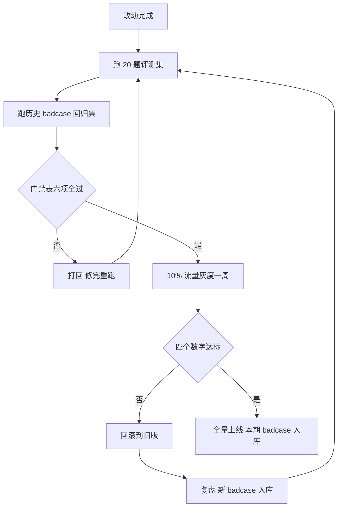

# 11 上线门禁与评测集

> **一句话结论**：上线不是「工程说好了」，是**过门禁**。门禁 = 一组固定的题 + 一组事先定好的阈值 + 一个敢说不的人。缺任何一个，门禁就只是装饰。

---

## 一、为什么 PM 要懂这个

周五下午的上线评审，对话通常是这样的：

> 你：这一版多少题测过？
>
> 工程：测了挺多的，感觉没问题。
>
> 你：上次那个把退款金额算错的 case，这版过了吗？
>
> 工程：那个……应该早修了吧。
>
> 你：通过率多少？谁签字？
>
> 工程：……

会议室里没人能回答这三个问题，但版本还是上了。第一周，同一个退款算错的 case 又出现一次，用户截图发到群里。

复盘时你会发现，缺的不是「测试」，是三样具体的东西：

1. **没有固定的题。** 「测了挺多」意思是每次测的都不一样，所以两版之间没法比。
2. **没有事先定的阈值。** 「感觉没问题」不是标准，是心情；而且心情会随着上线日期临近而变好。
3. **没有否决人。** 一屋子人都点头，等于没有人负责。

这三个缺口，工程补不了，因为它们全是产品该定的。

---

## 二、机制

### 门禁的三个零件

| 零件 | 是什么 | 缺了会怎样 |
|---|---|---|
| 固定的题 | 20 道，按 badcase 类型分桶，题不随版本改 | 每版测的东西不同，无法比较「变好还是变坏」 |
| 阈值 | 上线前写死的数，不是上线时商量的数 | 越接近上线，阈值越容易被谈低 |
| 否决人 | 一个具体的人名，不是「团队」 | 出事时无人负责，事前无人敢拦 |

顺序也很重要：**题和阈值在立项时定，在评审时只是执行**。如果你在评审会上才第一次看到这张表，那它一定过。



**一个类比**：门禁像机场安检。安检不是「你觉得没问题就走」，是「过机器、看指标、有人有权把你拦下」。安检慢，但它是唯一让所有人对结果有预期的东西；取消安检，航班不会更快，只会更不可预测。

### 一张能直接用的门禁表

阈值为示例，按你的业务改；但**表格结构不要改**——每一行必须有「怎么测」和「不过怎么办」，缺这两列的阈值只是口号。

| # | 指标 | 阈值（示例） | 怎么测 | 不过怎么办 |
|---|---|---|---|---|
| 1 | 召回命中率 | ≥85% | 20 题里「资料存在且被取到」的比例 | 补检索、补文档，不上线 |
| 2 | 忠实度 | ≥90% | 答案的每个论断能否被引用段落支持 | 收紧引用校验，或换模型 |
| 3 | 拒答题编造 | 0 条 | 5 道资料外的题，必须拒答或转人工 | 一票否决，没有例外 |
| 4 | P95 延迟 | ≤6s | 200 并发压测 | 砍检索条数、上流式输出 |
| 5 | 单次成本 | ≤¥0.15 | 账单 ÷ 会话数，灰度期实测 | 路由、上下文瘦身 |
| 6 | badcase 回归 | 0 倒退 | 历史 badcase 全跑一遍 | 打回，修完重跑 |

第 3 行值得单独说：**它是唯一一个「一票否决」项**。因为编造是唯一一种用户无法自行发现、却会据此做决定的错误。延迟慢用户会等，成本高公司会疼，编造会让用户拿着错的答案去办事。

### 回归集：AI 产品最像软件工程的地方

回归集就是「历史 badcase 的集合」。每条记三样：

```text
现象：用户问退款多久到账，答「3 个工作日」，实际是 7 个
根因：检索取到的是旧版规则
期望行为：答 7 个工作日；若取到旧版，应带版本提示或拒答
```

它从 3 条长到 200 条，每一条都是线上真实踩过的坑。每次改动跑一遍，**不许有任何一条从「过」变成「不过」**。

这件事最容易被跳过，原因很实在：它不产生新功能、需要有人维护、而且总有一种「上次那个早修好了」的错觉。但它是唯一能防「修 A 坏 B」的机制——而 AI 产品最典型的翻车方式，就是修 A 坏 B。prompt 改一句、检索多取两条、换个模型，都可能让三个月前那个 case 复发。

成本没有想象中高：200 条 × 40 秒，机器跑两小时；人只需要看「和上版不一样的那几条」，通常 30 分钟。

### 灰度：10% 跑一周，看四个数

灰度不是「放一点流量看看」，是「带着红线跑一周」。四个数在灰度前就要定好：

| 数字 | 基线（示例） | 红线（示例） | 说明 |
|---|---|---|---|
| 任务通过率 | 78% | 跌超 5 个百分点 | 主指标，跌了就是变差 |
| 拒答率 | 5% | 涨超 1 倍 | 涨说明资料或检索退化 |
| 人工转接率 | 12% | 涨超 30% | 用户在用自己的脚投票 |
| 单次成本 | ¥0.12 | 超 1.3 倍 | 路由或重试出了异常 |

四条里任意一条破线就回滚，**不需要再开会讨论**。回滚要能在 10 分钟内完成——所以灰度之前你必须问一句：「回滚开关在哪，谁有权按？」问不出来，这个灰度就是提前上线。

---

## 三、产品视角：这条技术决定了什么决策

**1. 门禁表写进 PRD，阈值与否决人在立项时就定。**
判断标准：PRD 里有没有那张表，以及一个具体的人名。代价：立项时多花两小时对齐指标口径——这两小时买的是后面三个月不扯皮。

**2. 阈值宁可松一点，但必须真跑。**
判断标准：这套门禁是否连续三个版本都跑过。代价：每次 40 分钟。定一个跑不到的严格阈值，比定一个松但每次都跑的阈值更糟。

**3. 回归集是资产，必须有 owner。**
判断标准：谁负责把线上 badcase 加进去、多久加一次。代价：每周一小时。没有 owner 的回归集，三个月后就是一堆过期题目。

**4. 灰度前把「看到什么就回滚」写死。**
判断标准：灰度方案里有没有红线，以及一个能在半夜按下回滚的人。代价：可能灰度一周就回滚，白跑——但这比一次全量事故便宜。

---

## 四、上手

两个现成的东西：

- `demos/05_eval_set.py`：10 道题，同一套题跑 v1 和 v2 两版，每题按「召回 / 忠实 / 有用」各打 0/1/2，最后拿阈值判一次门禁——过没过、卡在哪一项。它演示的是把「人工判断」翻译成可重复的断言：不是看总分，是看**每一题为什么掉分**。
- `templates/评测集-20题模板.csv`：20 行、10 列（编号 / 用户原话 / 考察点 / 期望必须包含 / 题目来源 / 召回分（0/1/2）/ 忠实分（0/1/2）/ 有用分（0/1/2）/ 是否通过 / 备注）。直接往里填，别自己造格式——列一改，你的卷子就没法和上一版、和别人比了。

15 分钟纸上推演：给你的功能写 6 行门禁表。

1. 指标栏只填你**真的能测**的，别抄「用户满意度」这种测不出的。
2. 每行必须写「怎么测」——写不出测法，就删掉这一行。
3. 写「不过怎么办」，写不出动作的，说明这条门禁没人执行。
4. 最后在表下面写一个名字：谁有权说不。

---

## 五、常见误判（反面清单）

**「评测集越大越好。」**
实际：20 道覆盖 6 种 badcase 类型的题，比 200 道随机题有用得多。数量不解决覆盖问题。
怎么验证：看这 20 题是否来自你的 badcase 分桶，每桶至少 2 题。

**「让模型自己打分就行，快。」**
实际：模型评审偏爱长答案、偏爱自己的措辞，和人工判断的一致率可能只有七成。
怎么验证：人工标 20 条，和模型打分对比，算一致率；低于 80% 就不能全自动。

**「灰度就是放 10% 流量跑跑看。」**
实际：没有红线和回滚人的灰度，只是把上线提前了一周，风险一点没少。
怎么验证：看灰度方案里有没有那四个数、红线、以及谁按回滚。

**「门禁会拖慢上线。」**
实际：一次门禁 40 分钟；一次线上事故的平均成本是几个人处理几天，加上用户信任的折损。
怎么验证：算一下你们上一次事故，一共花了多少人时。

---

## 六、30 分钟练习

交付一页「门禁卡」：

1. 6 行门禁表：指标 / 阈值 / 怎么测 / 不过怎么办。
2. 一个名字：谁是否决人（可以是你的上级，但必须是人名）。
3. 一条回滚条件，写成「如果 ___，就在 ___ 分钟内回滚」。
4. 一条 badcase 入库规则：什么样的线上问题会被加进回归集，谁加。

第 2 条最容易卡住。卡住本身就是收获——**说明你现在这个项目，出事了没人负责**。

---

## 90 秒话术

> 「上线不是工程说好了，是过门禁。门禁三个零件：一组固定的题、一组事先定好的阈值、一个敢说不的人。没有固定的题，两版没法比；阈值上线时才定，一定会被谈低；没有否决人，一屋子人点头等于没人负责。
>
> 我最看重回归集：每条 badcase 记成现象、根因、期望行为，每次改动全跑一遍，一条都不许倒退。这是 AI 产品最像软件工程的地方，也最容易被跳过。
>
> 灰度我只认四个数：通过率、拒答率、转接率、成本，破线就回滚，不开会。」

---

> 想读源码：`promptfoo/promptfoo` → `src/assertions/`（看「不能编造」「必须引用」这类要求，是怎么被写成一条条可执行、可批量跑的断言的）。

**下一讲** → [12 需求拆解：该不该用 Agent](../05-产品/12-需求拆解-该不该用Agent.md)：门禁管的是「能不能上」，下一讲管的是「该不该做」。
