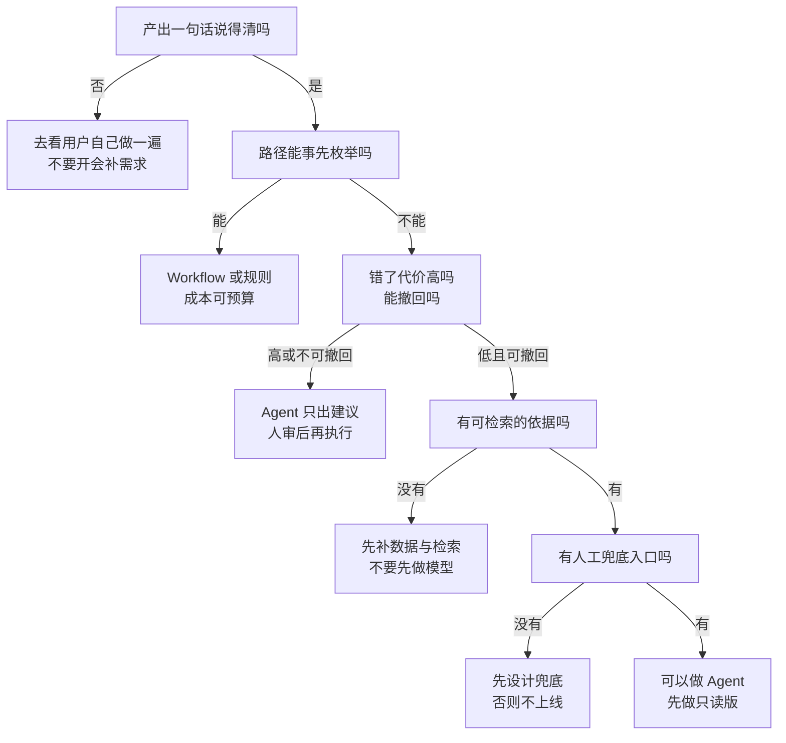

# 12 需求拆解：该不该用 Agent

> **一句话结论**：需求拆解的产出不是方案，是**边界**——做什么、不做什么、什么情况交给人。判断该不该用 Agent 只需要五问，任意两问答不上来，就先退回 workflow 或规则。

---

## 一、为什么 PM 要懂这个

周三下午，业务负责人把手机推到你面前：

> 「竞品给销售上了个 AI 助手，能自己查客户、写完邮件直接发。我们也做一个，下个月上。」

你转头问工程：「能做吗？」
工程说：「看你要什么。」

这句话不是推诿，是你没给边界。业务要的是「销售每天少花 40 分钟」；工程听到的是「一个生成接口」；销售要的是「别让我改半小时」。三句话，其实是三个产品。

三周后版本上线，功能是「输入客户名，生成一封跟进邮件」。两周数据：覆盖销售 120 人，日活 9 人，累计生成 41 封，被直接采纳 6 封——14.6%（示例）。销售的原话是：

> 「它写的不像我，我还得改半小时，不如自己写。」

复盘时你会发现，问题不在模型，在第一天：业务说的「AI 助手」是**手段**，他真正要的是**产出**。你按手段排了期，就只能交付一个能演示的东西。

---

## 二、机制 / 方法

### 1. 五问拆解

拿到任何「要不要上 AI」的需求，先按顺序问这五个问题。注意顺序：① 决定后面四个怎么答。

| # | 要问的问题 | 怎么算「是」 | 答「否」时先做什么 |
|---|---|---|---|
| ① | 用户真正要的产出是什么 | 一句话说清「谁、在什么场景、多久内、拿到什么、拿去干什么」 | 回到用户身边看他做一遍，别开会补需求 |
| ② | 完成路径能不能事先枚举 | 能画出 3–7 步，且第 2 步不依赖第 1 步的返回 | 先做 workflow 或规则，别上 Agent |
| ③ | 错了代价多大、能不能撤回 | 能说清最坏情况，且能撤销或有人复核 | 加人审或确认步，自动化只到「建议」 |
| ④ | 数据够不够 | 能指出答案应来自哪 2–3 个数据源，且取得到 | 先补数据与检索，别先做模型 |
| ⑤ | 谁来兜底 | 有明确入口、明确接手人、明确响应时长 | 先设计兜底，没有就不上线 |

一句话记法：**①是产出，②是路径，③是风险，④是依据，⑤是退路。** 五个里最容易糊弄的是 ①——它听起来最像废话，却决定后面四个的答案。

### 2. 五问怎么串成判定

五问之后，用这张表定档。**注意第一行：两问答「否」是硬门槛，不是加权平均。**

| 五问的结果 | 判定 | 理由 |
|---|---|---|
| 任意两问答「否」 | 先做 workflow 或规则 | 两个不确定性叠在一起，排期和成本都不可承诺 |
| ② 路径能枚举 | 直接 workflow | 能用流程图写清的事，不需要模型来「决定」 |
| ③ 代价高或不可撤回 | 必须人审或确认步 | 模型可以犯错，产品不能让错误直接生效 |
| ④ 数据不足 | 先补数据，别先做模型 | 没有依据时模型只能编，换更贵的模型只会编得更流畅 |
| 五问全「是」 | 才考虑 Agent，且先只读 | 先能查、不能写，把价值跑出来再加权限 |

### 3. 一个生活类比

这五个问题像请客点菜。**套餐**（workflow）是八道菜、600 元、40 分钟上齐，你能提前跟老板报账；**「你看着办」**（Agent）可能更惊艳，也可能账单 2000、等到 90 分钟。选哪个不取决于厨师水平，取决于你能不能接受「账单不可预期」。

多数 To B 场景不能。所以多数场景的正确答案是「套餐 + 两道单点」，不是「全交给厨师」。

### 4. 完整拆解：帮销售写客户跟进邮件

同一个需求，三种做法，差别不在技术，在边界。

| | A：模板 + 变量填空 | B：检索 + 生成 | C：Agent 全自动 |
|---|---|---|---|
| 怎么做 | 3 套模板，变量填客户名、上次沟通、产品 | 取该客户近 90 天邮件与工单 top 5，生成草稿，销售改 | 查 CRM，查往来邮件，写，直接发送 |
| 上线时间（示例） | 2 天 | 3 周 | 10 周 |
| 单次成本（示例） | 0 元 | 0.03 元 | 0.35 元，失败重试另算 |
| 效果（示例） | 采纳率 20%，销售仍要改 4 分钟 | 采纳率 45%，只改 2 分钟 | 未验证；发错一次客户就是事故 |
| 风险 | 低 | 低（只是草稿） | 高：发错人、承诺错价格、撤不回 |

**结论：先做 B。** 不是因为 B 更先进，是因为 B 的增量正好落在用户最痛的那一步——销售不是「不会写」，是「不想翻三个系统找上次聊到哪」。

- A 是 B 的兜底：检索不到就用模板，保证永远有东西可用。
- C 的能力拆成「建议 + 人工确认」：自动查（只读）、自动写草稿、销售点发送、系统记录采纳率与修改率。
- 发送这一步留给人，成本降一个数量级，风险降一个数量级。

还有一个容易被忽略的数字：B 相对 A 的提升，八成来自「把上次沟通记录塞进上下文」，不是换了个更贵的模型（示例）。所以 B 的第一版应该先做检索，再调 prompt。

### 5. 反模式：「AI 味需求」

需求文档写「用大模型提升体验」，但没有可验收的产出——这就是 AI 味。它的共同点是：句子都对，但没有一个词能被验证。

| | 写法 | 问题 |
|---|---|---|
| 坏 | 「用大模型提升销售写信体验，支持智能生成、个性化推荐。」 | 没有主语、没有数字、没有边界，谁都能说做完了 |
| 好 | 「销售在客户详情页点『写跟进』，8 秒内出草稿；草稿须含上次沟通要点与下一步动作；从点击到发出中位数 ≤90 秒；30 天采纳率 ≥40%；发送前必须人工确认。」 | 有场景、有数字、有边界、有验收 |

改写的关键不是加形容词，是加三个东西：**时间、比例、谁签字**。任何一个加不上，说明这个需求还没想清楚。

---

## 三、产品视角：这条技术决定了什么决策

1. **需求拆解的产出是边界，不是方案。** 判断标准：一页纸能写清「做什么 / 不做什么 / 什么情况交给人」。代价：写不出边界，工程会用最省事的方式替你决定，最后你验收的是一个你没想要的东西。
2. **自动化程度由「错了的代价」决定，不由模型能力决定。** 标准：按可撤回与不可撤回分级，不可撤回的动作必须留确认步。代价：把发送、付款、删除交给模型，一次事故能抵消一年的效率收益。
3. **路径能不能枚举，决定你的成本是「预算」还是「赌」。** 标准：workflow 的单次成本能算到分；Agent 的成本是步数分布的长尾。代价：拿 workflow 的预算去承诺 Agent 的毛利，规模化那个月一定爆。
4. **数据不足时，最贵的动作是「先做模型」。** 标准：先说清答案来自哪 2–3 个数据源。代价：没有依据，你连评测集都造不出来——因为不知道什么叫「对」。
5. **兜底不是按钮，是承诺。** 标准：入口在第几屏、谁接、多久接。代价：一个点击率 3%（示例）的转人工按钮，等于告诉用户「你自己想办法」。

---

## 四、上手：30 分钟做一张「需求边界卡」

材料：一张 A4、一个本周真实被提的需求。

1. **（5 分钟）写产出句。** 「＿＿（谁）在＿＿（场景）下，＿＿内拿到＿＿，用来＿＿。」写不出，把缺的信息列成 3 个问题，先去问人。
2. **（10 分钟）五问逐条打勾。** 是 / 否 / 不知道。「不知道」一律按「否」处理——保守，而且便宜。
3. **（10 分钟）按判定表定档。** 规则 / workflow / Agent（只读）/ Agent（可写 + 人审）。
4. **（5 分钟）写三个数字。** 时延上限（示例 90 秒）、单次成本上限（示例 0.05 元）、采纳率下限或错误率上限（示例 采纳率 ≥40%）。

**交付物**：一张 A5 卡，四行——产出句 / 五问结果 / 档位 / 三个数字。
**验收**：给一个没参与的人看 30 秒，他能说出「这个月你们不做什么」。

---

## 五、常见误判（反面清单）

| 你会听到的说法 | 实际是什么 | 怎么验证 |
|---|---|---|
| 「用户说要 AI」 | 「AI」是他对手段的猜测，他要的是省时间或少犯错 | 让他把上次做这件事的完整过程走一遍并掐表，看 80% 时间花在哪 |
| 「Agent 更先进，所以做 Agent」 | 多步执行会把单步错误率乘起来：单步 95%，5 步端到端只剩 77%（示例） | 算端到端成功率，不算 demo 里的单步成功率 |
| 「先做出来，验收指标上线再定」 | 没有指标就没有「做完」，只有「做不下去」 | 问「这版低于哪个数算失败」，答不出就是没定义 |
| 「加个转人工就安全了」 | 兜底的安全感来自触达率与响应时长，不是按钮存在 | 走一遍空结果、超步数、断网，看用户看到什么、多久有人接 |

---

## 六、30 分钟练习

1. 选一个最近被提的「AI 需求」，用边界卡填一遍（20 分钟）。
2. 写出 A / B / C 三档，每档标：上线时间、单次成本、最坏情况（10 分钟）。
3. 用一句话说「这版不做什么」，讲给一个非技术同事，他能复述（5 分钟）。

**交付物**：一张边界卡 + 一句「不做什么」+ 三个数字。
**加练**：拿给工程看，只问一句「按这个边界，你觉得哪一步会先出问题」。

---

## 90 秒话术

> 「拿到一个 AI 需求，我先问五个问题：用户要拿到什么产出、路径能不能事先枚举、错了代价多大、有没有可检索的依据、谁来兜底。任意两问答不上来，就先做 workflow 或规则。」
>
> 「因为 Agent 的成本和错误率是乘起来的，不是加起来的。我最常做的动作，是把『全自动』拆成『建议加人工确认』——省掉的是查资料和打字，不是那个发送键。」
>
> 「所以需求拆解的产出不是方案，是边界：做什么、不做什么、什么情况交给人。」

---

**下一讲** → [13 Agent PRD 模板](13-Agent-PRD模板.md)：把边界写成工程能照着建、评测能照着判的规格。
