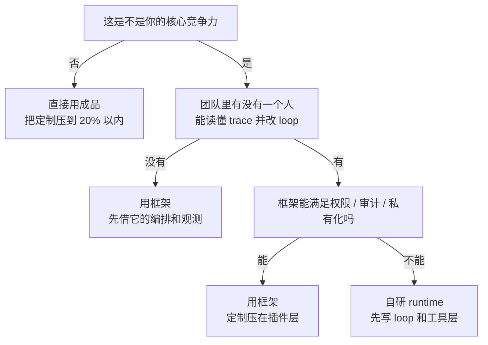

# 14 选型决策树：自研、框架还是成品

> **一句话结论**：选型不是技术决策，是**你未来 12 个月能承诺什么**的决策。先算退出成本，再算上手速度；只算前者的人，通常在第七个月开始重写。

---

## 一、为什么 PM 要懂这个

季度规划会，白板上写着三个选项：直接买、用框架、自己写。

老板问：「我们到底用 Dify，还是自己写？」
技术负责人说：「LangGraph 更灵活。」
另一个工程说：「自己写也就两周。」

会议开了 40 分钟，没人回答真正的问题：6 个月后最大的客户要求私有化部署，12 个月后要过审计，团队只有 1.5 个后端（示例）。

最后选了框架。3 周上线，很顺。第 7 个月，客户要「按部门隔离权限 + 全量操作审计」——框架的权限模型只到工作空间一级，改不动；fork 之后，每次升级要合 2000 行冲突（示例）。第 9 个月用 6 周重写 runtime，评测集重建 2 周。

事后看，技术没选错。错在会上讨论的全是「多久能上」，没人问一句：

> 「如果这条路走不通，我们多久能换一条，代价是什么？」

这类会的典型结构是：三个人各推荐一个自己熟悉的东西，然后比参数。参数都比得出，唯独「我们能不能维护它」比不出来——因为那取决于人，不取决于产品。

---

## 二、机制 / 方法

三条路，先看清各自卖的是什么。

| 路 | 你买到什么 | 你欠下什么 | 典型选择 |
|---|---|---|---|
| 成品 | 已经调好的产品与体验 | 数据边界、定制空间 | Claude Code、Copilot、现成 SaaS |
| 框架 | 编排、工具、观测的 70% | 抽象层理解成本、升级绑定 | LangGraph、Dify、Coze |
| 自研 | 完全控制与可审计 | 人、时间、长期运维 | 自己写 loop / tools / memory |

三条路不是成熟度阶梯：不是「先成品、再框架、最后自研」。不少公司一直用成品也活得很好；也有公司自研了一个只有一个人看得懂的 loop。选的是这一年的约束，不是公司的段位。

像住房子：成品是**租精装**，拎包入住，但承重墙不能动；框架是**买精装改软装**，能改，但物业有规定；自研是**自己盖**，什么都能改，只是屋顶漏水时得有人会修。

树的顺序不是随意的：先问核心竞争力（决定要不要投入），再问人（决定能不能维护），最后问约束（决定能不能用）。顺序反过来，就变成「先选技术，再找理由」。

### 三条路各自的死法

- **成品错在把核心能力外包。** 判断：这个能力如果明天竞品用同样价格就能买到，你还剩什么？数据出不去、定制只能提工单，都是这一条的变体。
- **框架错在为了 10% 的定制扛 100% 的抽象。** 判断：数一下定制点，3 个以内框架划算，超过 10 个，抽象税就超过自研（示例）。更隐蔽的是 fork——fork 那天起，你维护的是一个只有你看得懂的分支。
- **自研错在没有第二个能接手的人。** 判断：唯一读过 loop 的人请两周假，系统还能不能改？不能的话，你买到的不是控制权，是单点。

三条路的死法有个共同点：都不是技术失败，是组织失败——没人算退出成本、没人维护抽象层、没人能接手。

| | 成品 | 框架 | 自研 |
|---|---|---|---|
| 上手速度（示例） | 1 天 | 1–2 周 | 4–8 周 |
| 单位成本 | 订阅费，高但可预算 | 中：人力 + 模型 | 边际低、固定成本高 |
| 可控性 | 低：只能改 prompt 和配置 | 中：能改节点和工具，改不了内核 | 高 |
| 迁移成本 | 高：数据和流程被锁 | 中高：prompt 和评测能带走，编排要重写 | 低，但换人成本高 |
| 团队要求 | 0.2 个人维护 | 1 个懂编排的人 | 至少 2 个能接手的人 |
| 适合阶段 | 验证期、非核心场景 | 场景明确、要快 | 核心链路、合规硬约束 |

### 把账算到第 12 个月

| 项目（示例） | 成品 | 框架 | 自研 |
|---|---|---|---|
| 一次性投入 | 0 | 2 周接入 | 8 周开发 |
| 每月固定 | 订阅 1 万 | 0.5 人 + 模型 3000 元 | 1 人 + 模型 3000 元 |
| 第 12 个月的一次改造 | 提工单等排期 | 改插件，2 周 | 自己改，1 周 |
| 隐藏项 | 坐席涨价、数据出不去 | fork 后每次升级冲突 | 招人、值班、没人接手 |

差别不在前 12 个月，在第 13 个月你还有没有选择。

### 混合路线：框架跑编排，关键一层自研

多数团队的真实答案是这条：编排、观测、重试用框架，权限层、审计层、工具层自己写。它买到的是速度，保住的是边界。代价是你要维护一层「框架升级时不会坏的接口」——判断标准：升级框架小版本，你的自研层要不要改代码；要改，就说明耦合了。

### 最容易被忽略的一项：迁移成本

大家以为迁移丢的是代码。其实 loop 只有 300–800 行（示例），一个人两周能重写。真正丢不掉的是三样：

1. **prompt 资产**：工具描述、拒答话术、few-shot 例子。这些是几百次线上失败换来的，重写等于把踩过的坑再踩一遍。
2. **评测集**：30–50 题加标注口径，重建要 2–4 周，而且新标的和旧标的不等价——你没法证明「新版没变差」。
3. **操作习惯**：灰度节奏、回滚开关放在哪、谁每天看哪个数。

所以判断迁移成本，不看代码量，看一次 **2 天的迁移预演**：让一个人把现有 5 个工具在目标方案里重新接一遍，记录改了多少 prompt、漏了多少评测题。这个数字比任何架构对比图都诚实。

反过来说，如果你现在就在框架上，有一件事今天能做：把 prompt 和评测集从框架里抽出来，存成独立文件。抽出来那天，你已经付掉一半迁移成本了。

### 谁来做这个决定

选型会不该由最懂技术的人单独拍板，也不该由最不懂的人单独拍板。让技术单独拍，优化目标会变成「架构漂亮」；让老板单独拍，优化目标会变成「便宜」。合适的人是对 12 个月承诺负责的那一个——通常是产品负责人，因为他要在评审会上说出「这个需求我们不接」。代价：他得能读懂那张成本账，而不是只签个字。

---

## 三、产品视角：这条技术决定了什么决策

1. **选型是你未来 12 个月能承诺什么的决策。** 标准：三条路各写一张「12 个月承诺卡」——能接什么需求、不能接什么。代价：选错不是慢，是承诺了做不到的事。
2. **合规与数据边界要在第一周问，不要等第 8 个月。** 标准：私有化、审计日志、数据出境三个问题有明确答案。代价：发现数据出不去那天，迁移成本等于一次重做。
3. **把「退出成本」和「上手速度」并列写进决策文档。** 标准：2 天迁移预演能不能跑通。代价：只算上手速度，会选到一条越走越窄的路。
4. **团队里那个「能读 trace 的人」是前提，不是结果。** 标准：他休假两周，系统还能不能改。代价：没有这个人，框架和自研都会烂在内核之外。
5. **PRD 里写一句退路：触发条件、切到哪、预算多少。** 代价：没写退路，失败时唯一的选项是加人。

---

## 四、上手：30 分钟做一张「选型一页纸」

1. **（5 分钟）定性。** 写下：这是核心还是非核心。判断句：「如果它明天被竞品用同样价格买到，我们还剩什么？」
2. **（10 分钟）三条路各填四格。** 上线时间、12 个月总成本、退出成本、第一个会死的信号。
3. **（10 分钟）压力测试三条。** 私有化、全量审计、核心作者离职——逐条问「这条路怎么办」。
4. **（5 分钟）写退路。** 「如果＿＿（信号），我们在＿＿周内切到＿＿，预算＿＿人周。」

填完大概长这样（示例）：

| | 成品 | 框架 | 自研 |
|---|---|---|---|
| 上线时间 | 3 天 | 3 周 | 8 周 |
| 12 个月成本 | 12 万 | 18 万 | 30 万 |
| 退出成本 | 高：数据迁移 4 周 | 中：重接 5 个工具，2 周 | 低：代码在手上 |
| 会死的信号 | 客户要求私有化 | 权限模型改不动 | 只有一个人能改 |

**交付物**：一页 A4，4 行结论 + 1 句退路 + 1 个你会盯的失败信号。
**验收**：让工程挑一个「你没算到的成本」，把它补进表里；补不进去，说明这张纸能拿去开会了。

---

## 五、常见误判（反面清单）

| 你会听到的说法 | 实际是什么 | 怎么验证 |
|---|---|---|
| 「先用框架快上线，以后再说」 | 以后不会来；迁移成本在第 7–12 个月集中到期，那时你最没时间 | 现在做 2 天迁移预演，看要动多少 prompt 和评测题 |
| 「自研才有护城河」 | 护城河是数据、评测集、分发；loop 是最容易被复制的一层 | 问「别人照抄这部分要多久」，答「两周」就不是护城河 |
| 「开源和框架免费」 | 免费的是许可，贵的是人：懂编排的人月、升级维护、定位问题的时间 | 算 12 个月人力，不要只算订阅费 |
| 「成品不能定制，所以不用」 | 多数定制需求能落在配置和外围系统里 | 列 10 个定制点，看几个必须改内核（示例：8 个不用） |

这四句话的共同点：都在比较工具，没人比较「我们能不能维护它」。而后者才是第 7 个月会疼的地方。

---

## 六、30 分钟练习

1. 给手上一个功能做「选型一页纸」（15 分钟）。
2. 做反向选择：预算砍半、工期砍半，你改选哪条，为什么（10 分钟）。
3. 把三条路的「第一个会死的信号」写成一句能贴墙的监控指标（5 分钟）。

**交付物**：一页 + 一句退路 + 一个失败信号。
**加练**：把「核心作者离职」这条压力测试讲给团队听，看有没有人沉默——沉默的那个人通常就是 bus factor。

---

## 90 秒话术

> 「选型不是技术决策，是我未来 12 个月能承诺什么的决策。所以先算三个数：多久能上、12 个月总成本、退出成本。」
>
> 「三条路各有各的死法：成品死在核心能力外包，数据出不去；框架死在为 10% 的定制扛 100% 的抽象，fork 之后升级就断；自研死在只有一个人能接手，他一休假系统就没人敢改。」
>
> 「我最坚持写进文档的是退路：如果这条路失败，我们多久切、切到哪、花多少人周。没写退路的选型，本质是把风险留给下个季度。」

---

**下一讲** → [15 三十问与三十秒回答](../06-面试/15-三十问与三十秒回答.md)：把前十四讲的判断，压缩成能说出口的 30 秒。
