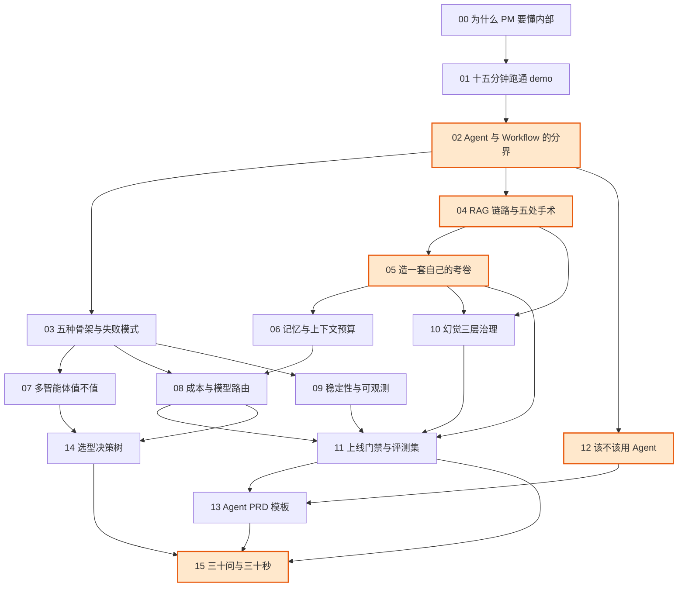

# AI 产品经理的 Agent 技术底座

[](https://github.com/carrot220283-eng/ai-pm-agent-course/actions/workflows/check.yml)
[](https://creativecommons.org/licenses/by-nc-sa/4.0/deed.zh)
[](LICENSE)

> 14 讲，把 Agent / RAG / 上下文 / 上线工程，翻译成产品决策。
> 不讲怎么造模型，讲**怎么判断、怎么提需求、怎么验收**。

---

## 这门课是什么

市面上 AI 产品课分两种：一种讲「大模型能干什么」——听完你还是不知道怎么和工程对齐；一种讲「怎么训模型」——你不需要，也用不上。

这门课补的是中间那层：**Agent 系统内部到底在发生什么，以及这件事如何决定你的产品决策。**

每一讲都按同一个结构写：

```
一句话结论 → 为什么 PM 要懂 → 原理（一张图 + 一个类比）
→ 可跑的 demo → 产品视角（这条技术决定了什么决策）
→ 90 秒话术（面试/汇报直接用）→ 30 分钟练习
```

## 适合谁

- 想投 **AI 产品 / AI 产品实习生**，但被「Agent、RAG、上下文、评测」这些词挡在门外的人
- 已经在做 AI 产品，天天听工程说「这个做不了」「这个是 prompt 问题」，但**没法判断他说得对不对**的人
- 非技术背景转 AI 产品（运营、设计、咨询、业务方），需要一套能听懂工程语言的坐标系

## 不适合谁

- 想学写代码找工作的人 —— 这里没有工程实现细节，代码只是为了让你「看见」机制
- 想学模型训练/微调的人 —— 那是另一条路，本课明确不碰
- 想要「AI 工具清单」「提示词大全」的人 —— 那些会过期，机制不会

## 学完你能做到（可验证）

1. 拿到一个需求，**30 分钟内判断**该用 workflow 还是 Agent，并说出理由和代价
2. 工程说「效果不好」，你能**当场给出 3 个排查方向**，并排优先级
3. 自己造一套**20 题的评测集**，用它决定「这版能不能上」
4. 写出一份**工程看得懂的 Agent PRD**（含停机条件、失败兜底、验收口径）
5. 面试被追问到「上下文爆了怎么办」「怎么控成本」，能答到**第二层**

## 三条学习路径

| 你有多少时间 | 走哪条 | 内容 |
|---|---|---|
| **4 小时**（面试前夜） | 速通 | 02 → 04 → 05 → 12 → 15 |
| **2 周**（每天 2 小时） | 系统 | 00 → 01 → 02…15 顺序走，每讲做练习 |
| **1 天**（只想解决问题） | 查字典 | 直接跳到对应讲，每讲都能独立读 |

## 14 讲之间的依赖

修一门课和读一门课的顺序不一样：读可以从任意点开始，但**后面讲的东西经常要求你先吃透前面的某讲**，否则那句话你只会觉得「有道理」而用不出来。这张图是实际依赖关系，橙色是面试前夜的速通路线。



三条箭头值得单独说，因为它们最容易读错：

- **05 → 11**：没有自己的考卷，就只有一个「上线门禁」的空表。门禁的阈值是被题目逼出来的，不是拍出来的。
- **09 → 11 / 08 → 11**：上线评审问的「出事怎么知道」「一个月要烧多少」，答案分别在 09 和 08 里，11 只是把它们收进一张表。
- **11 → 13**：PRD 里的验收口径不是写作技巧，是从评测和门禁里抄过来的。先有 11 才有 13 里那几行数字。

## 目录

### 00 开始这里
- [00 为什么产品经理要懂 Agent 内部](00-开始这里/00-为什么产品经理要懂Agent内部.md)
- [01 十五分钟跑通第一个 demo](00-开始这里/01-十五分钟跑通第一个demo.md)

### 01 认知
- [02 Agent 与 Workflow 的分界线](01-认知/02-Agent与Workflow的分界线.md)
- [03 五种骨架与它们的失败模式](01-认知/03-五种骨架与它们的失败模式.md)

### 02 知识
- [04 RAG 链路与五处手术](02-知识/04-RAG链路与五处手术.md)
- [05 RAG 评测：造一套自己的考卷](02-知识/05-RAG评测-造一套自己的考卷.md)
- [06 记忆与上下文预算](02-知识/06-记忆与上下文预算.md)

### 03 工程
- [07 多智能体：什么时候才值得](03-工程/07-多智能体-什么时候才值得.md)
- [08 成本与模型路由](03-工程/08-成本与模型路由.md)
- [09 稳定性与可观测](03-工程/09-稳定性与可观测.md)

### 04 质量
- [10 幻觉三层治理](04-质量/10-幻觉三层治理.md)
- [11 上线门禁与评测集](04-质量/11-上线门禁与评测集.md)

### 05 产品
- [12 需求拆解：该不该用 Agent](05-产品/12-需求拆解-该不该用Agent.md)
- [13 Agent PRD 模板](05-产品/13-Agent-PRD模板.md)
- [14 选型决策树：自研、框架还是成品](05-产品/14-选型决策树-自研框架还是成品.md)

### 06 面试
- [15 三十问与三十秒回答](06-面试/15-三十问与三十秒回答.md)

### 附件
- [demos/](demos/) —— 全部离线可跑，**不需要 API Key**
- [templates/](templates/) —— PRD 模板、20 题评测表、上线前 12 问

## 怎么跑 demo

不需要 OpenAI Key，不需要装任何第三方库（Python 3.9+ 即可）：

```bash
python demos/01_agent_loop.py       # 看一个 Agent 循环怎么跑、怎么死循环
python demos/02_rag_pipeline.py     # 看 RAG 最短的三种死法
python demos/03_context_budget.py   # 看上下文是怎么被挤爆的
python demos/04_breaker_retry.py    # 看熔断和重试怎么配合
python demos/05_eval_set.py         # 用 10 道题给一次改版打分
```

想接真模型时，设置环境变量即可（见 `demos/README.md`），代码一行不用改。

## 改完之后自检

改了文件、增删了讲、挪了目录之后，跑一条命令确认没拆坏东西：

```bash
python scripts/check.py
```

它检查四件事，任何一件不过就退出码 1：

1. 所有 Markdown 的相对链接都指向真实文件（改文件名最容易漏这里）
2. 每一讲都还带着「一句话结论 / 90 秒话术 / 练习」三节——结构是这门课的产品承诺，缺一节就不是同一门课了
3. 每一讲都还在 README 目录里（讲写了但没挂上，等于没写给读者）
4. 每个 demo 都还跑得通、真打印了东西，并且只 import 标准库

同一个脚本在 GitHub Actions 上跑两份环境（Ubuntu / Windows × Python 3.10 / 3.13）。我自己拿断链、删小节、加 `import requests`、让 demo 崩一次四种方式试过，四种都会红——一个从来不会失败的自检等于没有自检。

## 关于出处与版权

本课的**讲解、代码、模板全部为原创**，参考了若干开源 Agent 项目的公开设计（完整清单见 [SOURCES.md](SOURCES.md)）。

需要说明的是：被参考的仓库大多**没有 LICENSE**，因此本课**不复制其原文与代码**，只做概念与事实的转述、并给出原始链接供你深入。概念和事实不受版权保护，表达受保护——这条线我没有踩。

## 许可

- 文字（`*.md`）：[CC BY-NC-SA 4.0](https://creativecommons.org/licenses/by-nc-sa/4.0/deed.zh)
- 代码（`demos/*.py`）：MIT

---

**一句话**：你把这三层分清了，和工程的对话就不再是「能不能做」，而是「哪个方案、什么代价」。
